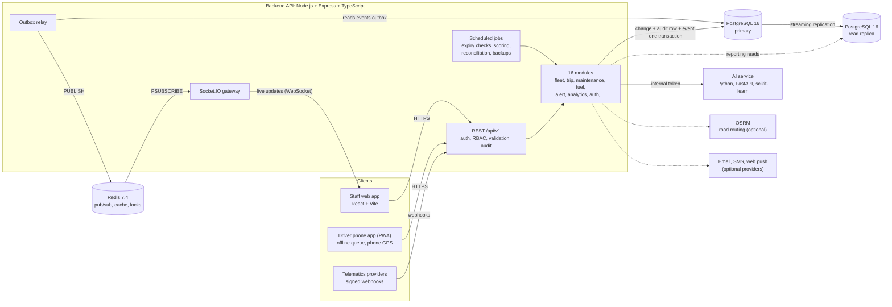

# Fleet Management System (FMS)

FMS is a web-based fleet management system for Ethiopian transport operators such as SMTSE and ACBSE. It replaces paper
job cards and scattered spreadsheets with one system for the whole working day:

- dispatchers assign trips and watch every vehicle on a live map;
- drivers run their day from a phone app that keeps working without signal;
- technicians log repairs against the parts they use;
- the finance office reconciles every litre of fuel against the trips that needed it;
- management sees utilisation, costs and risk on one dashboard.

Every change is written to an append-only audit log. The business rules are enforced by the server, so the app can't
get around them: no double-booked driver or vehicle, no expired licence on the road, no flagged vehicle dispatched.
A machine-learning service predicts which vehicles are likely to break down in the next 30 days, and which drivers are
likely to run late on a given trip.

This repository is the whole system: the web app, the API, the AI service, the database migrations, the seed data,
the load tests and the documentation.

> **Using FMS rather than developing it?** Read the [User Guide](docs/USER_GUIDE.md): one section per role, step by
> step, with screenshots. **Preparing the defence?** See [Defence notes](docs/DEFENCE_NOTES.md).

## Contents

- [What it does](#what-it-does)
- [Architecture](#architecture)
- [Tech stack](#tech-stack)
- [Quick start: running in five minutes](#quick-start-running-in-five-minutes)
- [Signing in: the demo accounts](#signing-in-the-demo-accounts)
- [Everyday commands](#everyday-commands)
- [Optional services](#optional-services)
- [Developing](#developing)
- [Repository layout](#repository-layout)
- [Configuration](#configuration)
- [Troubleshooting](#troubleshooting)
- [Documentation](#documentation)
- [Contributing and the Jira workflow](#contributing-and-the-jira-workflow)

## What it does

| Area | What people do in it |
|---|---|
| **Fleet** | Register vehicles and drivers (with Ethiopian licence classes), depots, documents with expiry warnings, photos; a full history per vehicle (repairs, trips with their GPS track, fuel, documents, health, recalls, incidents) |
| **Dispatch** | Create trips from planned routes or as one-off trips, and assign a driver and a vehicle. Business rules are checked on the server: no overlaps, valid licence for the vehicle, no flagged vehicle, daily and weekly driving-distance limits weighted by job load. Approved exceptions; arrival-time estimates |
| **Live operations** | The Fleet Command Center: every vehicle on a live map (Socket.IO), counters, alerts and incidents, focus on one driver, geofences |
| **Driver app** | An installable phone app (PWA). The driver's day, START and END TRIP, pre- and post-trip inspections (DVIR), fuel logs, incident reports, QR check-in at the depot gate, a monthly score. Works offline: submissions queue on the phone and are sent once, in order, when signal returns. The phone reports the vehicle's position during a trip |
| **Maintenance** | The repair log (parts deducted from stock, failures recorded), preventive service programs, recalls and warranties, spare parts with reorder levels, and a predicted health score (0 to 100) per vehicle |
| **Fuel** | Monthly reconciliation of fuel logged against what each vehicle's trips needed. Anomalies are flagged per vehicle and per fill-up, then resolved or dismissed with who did it recorded |
| **Analytics and reports** | KPIs (utilisation, cost per km, fleet cost, on-time trips), charts, fleet availability (MTBF, MTTR, downtime by reason), and monthly reports as CSV and PDF |
| **Administration** | Users and roles (invitation links, 9 roles, 62 permissions), settings for the rules' thresholds, audit log, database backups, system health, telematics providers, notification channels (in-app, email, SMS, web push) |

The nine roles are Admin, Fleet Manager, Dispatcher, Depot Admin, Maintenance Technician, Driver, Finance Clerk,
Compliance Officer and Fleet Owner. [docs/permissions.md](docs/permissions.md) lists who holds which permission, and
[docs/screen-inventory.md](docs/screen-inventory.md) lists who sees which screen.

## Architecture

FMS is a **modular monolith**: one Node.js API made of 16 modules, each owning its own PostgreSQL schema and talking to
the others only through their public interfaces. Two services run beside it: a Python service for the machine-learning
models, and optionally OSRM for road routing.



**The main components:**

| Component | Role |
|---|---|
| **Web app** (`packages/frontend`) | One React app with two layouts. Staff use a sidebar layout on desktop and tablet. Drivers use a phone layout with a bottom tab bar, a service worker and an IndexedDB offline queue. Menus are built from the user's permissions |
| **API** (`packages/backend`) | Express on Node.js, TypeScript strict. Every request is authenticated (HttpOnly cookie sessions with refresh rotation), authorised by permission *and* by depot scope, validated with zod, and audited. Modules: alert, analytics, audit, auth, backup, command-center, ev, fleet, fuel, integration, maintenance, privacy, realtime, settings, system, trip |
| **PostgreSQL 16** | The system of record. One schema per module (`fleet`, `trip`, `maintenance`, `fuel`, ...), plus platform schemas: `audit` (append-only: the app's role can't update or delete it), `events` (the outbox) and `jobs` (run history). 73 migrations |
| **Read replica** | A streaming hot standby. Reporting reads (fuel reconciliation, the audit log, analytics aggregation) go there. The API falls back to the primary when the replica is down or more than 30 s behind |
| **Redis 7.4** | Pub/sub between the outbox relay and the Socket.IO gateway on every API instance, the analytics cache, sign-in throttling, rate limits and job locks. It is a cache, not a store: the API keeps working from PostgreSQL when Redis is down |
| **AI service** (`packages/ai-service`) | FastAPI on Python 3.12, internal only (no published port). It serves two scikit-learn random-forest models: predictive maintenance (failure in the next 30 days, as a health score from 0 to 100), scored nightly, and trip risk (the chance a driver runs late, or has a safety event, on a given trip) for the dispatch board. Both models are trained when the image is built |
| **OSRM** (optional) | Road routing on Ethiopia's OpenStreetMap roads: route distances and times, the best order of stops, arrival-time estimates. Without it, routes keep the distance typed in |

**How a change travels.** A service writes its change, the audit row and a domain event in **one transaction**, with
the event going into `events.outbox`. If the change is rolled back, nothing is published; once it commits, the event
can't be lost. The outbox relay then:

1. broadcasts the event on Redis, where every API instance's Socket.IO gateway forwards it to the right rooms
   (depot-scoped);
2. dispatches it to the in-process consumers: alert rules, arrival-time estimates, read models.

Delivery is at least once, in order per aggregate ([docs/events.md](docs/events.md)).

**How a GPS position reaches the live map.** The driver's phone, or a telematics provider's webhook, posts positions to
`POST /tracking/gps-pings`. Ingestion validates them, stores them, updates the vehicle's location and runs the
telemetry rules (speeding, idling, geofences). It then publishes `VehicleLocationUpdated` through the outbox. Measured
at 500 vehicles reporting every 10 seconds, a position reaches 25 open dashboards in 273 ms at p95
([docs/load-testing.md](docs/load-testing.md)).

The architecture decisions are recorded in [docs/adr/](docs/adr/) and throughout `docs/`.
[CONVENTIONS.md](CONVENTIONS.md) gives the rules every module follows: money in integer cents and fuel in millilitres,
soft delete, IDs, permissions, errors, events, SQL.

## Tech stack

Versions are the ones the lockfiles and images pin.

| Layer | Technology | Version |
|---|---|---|
| Runtime | Node.js (Docker image `node:22-alpine`; local work needs 20.19 or newer) | 22 |
| Language | TypeScript, strict mode, in both apps | 5.9.3 |
| API | Express | 4.22.3 |
| Validation | zod | 4.6.7 |
| Auth | jose (JWT), @node-rs/argon2 (password hashing) | 6.2.12, 2.2.2 |
| Real time | Socket.IO, with @socket.io/redis-adapter | 4.8.4, 8.3 |
| Database | PostgreSQL, with node-postgres (`pg`) | 16, 8.23.1 |
| Cache and pub/sub | Redis, with ioredis | 7.4, 5.11.1 |
| Jobs, resilience, logs | node-cron, opossum (circuit breakers), pino | 4.6.0, 9.0.0, 10.4.0 |
| Metrics | prom-client (Prometheus) | 15.1.3 |
| Web app | React, React DOM | 18.3.1 |
| Build tool | Vite | 8.3 |
| Routing and data | React Router, TanStack Query | 6.30.6, 5.104.1 |
| Styling | Tailwind CSS, Inter, lucide-react icons | 3.4.19, 5.3, 1.47 |
| Maps and charts | Leaflet with react-leaflet, Chart.js | 1.9.4 / 4.2.1, 4.6.1 |
| AI service | Python, FastAPI, Uvicorn | 3.12, 0.143.0, 0.54.0 |
| Machine learning | scikit-learn, pandas, NumPy | 1.7.2, 2.3.3, 2.3.4 |
| Road routing (optional) | OSRM backend | 5.27.1 |
| Tests | Vitest (both apps), Testing Library, MSW, Supertest, pytest | 5.0.3, 16.3, 3.0, 7.3, 8.4.2 |
| Lint | ESLint, typescript-eslint, plus this repo's own rules (`packages/eslint-plugin-fms`) | 10, 8.71 |
| Containers | Docker Compose for development; separate production images ([docs/production-images.md](docs/production-images.md)) | |
| CI | GitHub Actions: 10 checks on every pull request ([docs/ci.md](docs/ci.md)) | |

## Quick start: running in five minutes

You only need **Git** and **Docker Desktop** (or Docker Engine with the Compose plugin). Node, Python and PostgreSQL
all run inside containers.

The first build downloads the images and trains the two models, which takes 5 to 10 minutes depending on your network.
After that a start takes under a minute.

### 1. Clone

```bash
git clone https://github.com/ZeekJager/senior-project-fms.git
cd senior-project-fms
```

### 2. Start the stack

```bash
make dev-bg
```

This does two things:

- **Creates `.env` on the first run**, with generated secrets: database passwords, the JWT signing key, the data
  encryption key, the Redis password and the ML service token. `.env` is git-ignored; never commit it.
- **Builds and starts six containers** in the background: PostgreSQL, its read replica, Redis, the API, the web app and
  the AI service.

Use `make dev` instead to keep the logs in the terminal.

No `make` (plain Windows)? Run the same two steps by hand from Git Bash or PowerShell:

```bash
node scripts/init-env.mjs        # or, without Node: docker run --rm -v "$PWD:/w" -w /w node:22-alpine node scripts/init-env.mjs
docker compose up -d --build --renew-anon-volumes
```

### 3. Create the database and the demo data

Wait until the API reports itself healthy (`docker ps` shows `fms_backend ... (healthy)`, usually within a minute), then:

```bash
make migrate                                 # create every table
FMS_SEED_PASSWORD=Demo-Pass-2026 make seed   # fill it with demo data; every demo account gets this password
```

`make seed` builds a small company: 3 depots, 24 vehicles, 30 drivers, 9 routes, 80 trips, fuel logs, repairs, spare
parts, attendance, GPS tracks and documents. It **wipes the dev database first**. Leave out `FMS_SEED_PASSWORD` and it
generates a password and prints it once at the end. `make seed SIZE=budget` builds the performance-budget scale (200
vehicles, 300 drivers, 1,000 trips; see [docs/seed-data.md](docs/seed-data.md)).

Without `make`:

```bash
docker exec fms_backend npm run migrate
docker exec -e FMS_SEED_PASSWORD=Demo-Pass-2026 fms_backend npm run seed -- --reset --size=small
```

**Then switch on the two models.** By design a new model scores nothing until an administrator has reviewed and
activated it ([docs/ml-model-registry.md](docs/ml-model-registry.md)). List them, then activate each version the list
shows (the version is named after the month the AI service's image was built, `pm-2026.11` and `tr-2026.11` here):

```bash
docker exec fms_backend npm run -s ml:model -- list
docker exec fms_backend npm run -s ml:model -- activate pm-2026.11 --by seed.admin@fleet.demo
docker exec fms_backend npm run -s ml:model -- activate tr-2026.11 --name trip-risk --by seed.admin@fleet.demo
```

The vehicles' health scores appear when the nightly scoring next runs. It catches up within 10 minutes of a seed,
because the seed resets the job history. If it already ran today without the model, they appear after 02:00
tomorrow. The trip risk hints appear on the dispatch board at once.

### 4. Open it

| What | Where |
|---|---|
| **The web app** | <http://localhost:5173>: sign in with an account below |
| The API | <http://localhost:3000/api/v1> |
| API reference (Swagger UI, development only) | <http://localhost:3000/api-docs> |
| Health | <http://localhost:3000/health/live> and <http://localhost:3000/health/ready> |
| PostgreSQL | `localhost:5432`, database `fms_db` (`make db-shell` opens psql) |
| The AI service | internal only: `http://ai-service:5000` inside the Docker network |
| Redis | internal only (no published port) |

The first page of the web app can take 20 to 30 seconds to appear while Vite compiles it. Later pages are quick.

## Signing in: the demo accounts

`make seed` creates one account per role. They all share the password you set with `FMS_SEED_PASSWORD`
(`Demo-Pass-2026` above). The seed is repeatable, so the same names appear every time.

| Role | Email | Lands on |
|---|---|---|
| Admin | `seed.admin@fleet.demo` | Dashboard (every screen) |
| Fleet Manager | `almaz.negash@fleet.demo` | Dashboard |
| Fleet Owner | `zewdu.lemma@fleet.demo` | Dashboard |
| Compliance Officer | `feven.yohannes@fleet.demo` | Dashboard |
| Dispatcher (Addis Ababa Central) | `kebede.kassa@fleet.demo` | Dispatch |
| Depot Admin (Addis Ababa Central) | `tigist.belay@fleet.demo` | Dashboard |
| Maintenance Technician | `solomon.haile@fleet.demo` | Repair log |
| Finance Clerk | `senait.negash@fleet.demo` | Fuel reconciliation |
| Driver | `meron.lemma@fleet.demo` | My day (open it at phone width, or on a phone) |

The other seeded people (most drivers, and the staff of the other depots) are *invited*: they have no password until
they open their invitation link. To add a real person, sign in as the admin and use **Users & roles → Invite user**
(see the [User Guide](docs/USER_GUIDE.md#invite-a-user)). Or create an account from the command line, which prints a
generated password once:

```bash
docker exec -it fms_backend npm run user:create -- --email you@example.com --name "Your Name" --role admin
```

**Trying the live map.** Sign in as the driver on a phone, or in a narrow browser window that is allowed to share its
location, and start an assigned trip: the phone becomes the vehicle's GPS. To see a whole fleet moving, run the GPS
simulator, which drives vehicles along their routes until you press Ctrl+C:

```bash
docker exec -it fms_backend npm run simulate:gps -- --vehicles 20 --interval 5 --duration 0
```

## Everyday commands

| Command | Does |
|---|---|
| `make dev` / `make dev-bg` | Build and start the stack, with the logs in the terminal or in the background |
| `make down` | Stop every container (the data stays) |
| `make clean` | Stop everything **and delete the database and uploaded files** |
| `make logs` | Follow every container's log |
| `make migrate` | Apply pending migrations |
| `make seed` | **Wipe** the dev database and fill it with demo data (`SIZE=small`, `budget` or `fleet500`; `SEED=<n>` for different but repeatable data) |
| `make db-shell` | psql in the database, as the app's role |
| `make backend-shell` / `make frontend-shell` / `make ai-shell` | A shell in that container |
| `make routing` | Download Ethiopia's roads and start OSRM (see below) |
| `make env` | Create `.env`, or add keys that `.env.example` gained since |

The backend and the web app reload on their own when you edit their source: both are mounted into their containers.
Restart the stack after changing `package.json`.

## Optional services

| Service | Turn it on | Without it |
|---|---|---|
| **Road routing** (OSRM) | `make routing` once: it downloads Ethiopia's OpenStreetMap extract and builds the road graph (about 10 minutes, kept in a volume), then starts OSRM. Add `COMPOSE_PROFILES=routing` to `.env` to start it with `make dev` ([docs/routing.md](docs/routing.md)) | Routes keep the distance typed in; no road shapes, stop ordering or arrival estimates by road |
| **Email, SMS and web push** | Provider keys in `.env` (`INTEGRATION_SMTP_EMAIL_API_KEY`, `INTEGRATION_SMS_GATEWAY_API_KEY`, `INTEGRATION_WEB_PUSH_API_KEY`; `npm run push:keys -w packages/backend` makes a VAPID key pair) ([docs/notification-channels.md](docs/notification-channels.md)) | Alerts reach people in the app only (the bell) |
| **S3 document storage** | `STORAGE_DRIVER=s3` and the `S3_*` keys in the backend's environment ([docs/api-contract.md](docs/api-contract.md) §8) | Documents are stored on local disk, in the `document_files` volume |
| **Telematics providers** | A provider row plus `INTEGRATION_<CODE>_WEBHOOK_SECRET` ([docs/telematics.md](docs/telematics.md)) | Positions come from drivers' phones and the simulator |

## Developing

### Running the tests

The tests run on your machine against the stack's PostgreSQL, so start the stack first (`make dev-bg`). You also need
**Node.js 20.19 or newer** for the JavaScript apps, and **Python 3.12** for the AI service.

```bash
npm ci                                       # once, and after package.json changes
npm test                                     # every backend and frontend test
npm run test:unit -w fms-backend             # backend unit tests only (no database)
npm run test:integration -w fms-backend      # backend integration tests (a throwaway fms_test database)
npm test -w fms-frontend                     # web app component tests
cd packages/ai-service && pip install -r requirements-dev.txt && pytest
```

Integration tests never touch your development data. Each run creates and migrates its own `fms_test` database, and
every test runs inside a transaction that is rolled back. See [docs/testing.md](docs/testing.md).

### Before you open a pull request

Run the checks CI runs. CI must pass before anything merges to `master`.

```bash
npm run lint -w fms-backend && npm run typecheck -w fms-backend
npm run lint -w fms-frontend && npm run typecheck -w fms-frontend && npm run build -w fms-frontend
npm test
```

CI ([docs/ci.md](docs/ci.md)) runs ten checks:

- **The app checks:** backend, frontend and AI service. That covers lint, types, tests with coverage, and the API
  matching `docs/openapi.yaml`.
- **Migrations:** each one up, down and up again.
- **The stack:** the whole Docker stack booting, and the production images built, scanned and smoke-tested.
- **The load test:** held to performance budgets.
- **Security:** a dependency audit and a secret scan.
- **The documents:** this README, the User Guide and the Defence notes pass markdownlint
  (`npx markdownlint-cli2@0.24.0`).

A pre-commit hook lints the staged backend files.

### Adding to it

- **A screen:** add it to `packages/frontend/src/router/routes.tsx` with the permission the API checks
  ([docs/portals.md](docs/portals.md#adding-a-screen)) and to [docs/screen-inventory.md](docs/screen-inventory.md).
- **An endpoint:** build it in its module, describe it in `docs/openapi.yaml` (a test fails otherwise) and in
  [docs/api-contract.md](docs/api-contract.md). Access tests cover it automatically from the route registry.
- **A table:** add a numbered migration in `packages/backend/migrations/` with its Up and Down
  ([migrations/README.md](packages/backend/migrations/README.md)).
- **A permission:** grant it in a migration, then regenerate [docs/permissions.md](docs/permissions.md) with
  `npm run -s permissions:doc -w fms-backend > docs/permissions.md`.

## Repository layout

```text
senior-project-fms/
├── packages/
│   ├── backend/              Node.js API (TypeScript)
│   │   ├── src/
│   │   │   ├── modules/      16 modules: alert, analytics, audit, auth, backup, command-center, ev, fleet,
│   │   │   │                 fuel, integration, maintenance, privacy, realtime, settings, system, trip
│   │   │   ├── shared/       platform: authz, cache, errors, events (outbox), http, jobs, logging, metrics, storage
│   │   │   ├── app.ts        the Express app
│   │   │   └── server.ts     HTTP server, Socket.IO, relay, jobs
│   │   ├── migrations/       73 numbered SQL migrations, each with Up and Down
│   │   ├── scripts/          seed, migrate, user:create, simulate:gps, load tests, backup restore, ...
│   │   └── test/             integration tests and their support
│   ├── frontend/             React web app (staff layout and the driver PWA)
│   │   └── src/
│   │       ├── pages/        one folder per screen
│   │       ├── components/   the design system: DataTable, Drawer, StatCard, Badge, ...
│   │       ├── router/       routes, menus and homes by permission
│   │       └── pwa/          service worker helpers and the offline queue
│   ├── ai-service/           FastAPI + scikit-learn: predictive maintenance and trip risk
│   └── eslint-plugin-fms/    this repo's lint rules (money as integers, module boundaries)
├── docs/                     specification, guides and every design document (see below)
├── docker/                   PostgreSQL init scripts and the replica's entrypoint
├── scripts/                  init-env.mjs and CI helper scripts
├── docker-compose.yml        the development stack
├── Makefile                  the commands above
└── CONVENTIONS.md            how we write code here
```

## Configuration

Settings come from `.env` at the repository root. [`.env.example`](.env.example) documents every key and its default.
`make env` writes `.env` with generated secrets and leaves an existing `.env` alone, only adding keys that are new. The
ones you may want to know about:

| Key | Meaning |
|---|---|
| `DB_ADMIN_PASSWORD`, `DB_APP_PASSWORD`, `DB_REPLICATION_PASSWORD` | PostgreSQL roles: the schema owner (migrations), the API's narrower role, and the replica's. Applied when the database volume is first created |
| `JWT_SECRET` | Signs sessions. Changing it signs everyone out |
| `DATA_ENCRYPTION_KEY` | Encrypts licence and phone numbers in the database. **Losing it makes that data unreadable**: keep a copy apart from the backups |
| `REDIS_PASSWORD`, `ML_SERVICE_TOKEN` | Internal service credentials |
| `VITE_API_URL`, `VITE_MAP_TILE_URL` | Compiled into the browser bundle: never put a secret in a `VITE_*` key |
| `FUEL_VARIANCE_THRESHOLD_PCT`, `ALERT_ESCALATION_MINUTES`, ... | Defaults for rules. Most are also changed on the Settings screen, which takes precedence |
| `CORS_ALLOWED_ORIGINS`, `TRUST_PROXY`, `RATE_LIMIT_*` | Security settings for a deployment ([docs/security.md](docs/security.md)) |

## Troubleshooting

| Symptom | Cause and fix |
|---|---|
| `relation "jobs.job_runs" does not exist` (or any `does not exist`) in the backend log | The database has no tables yet. Run `make migrate`, then `make seed` |
| The sign-in page says the email or password is wrong for a demo account | The seed was run without `FMS_SEED_PASSWORD`, so it generated one: look for "Their password" at the end of the seed's output, or seed again with the variable set |
| `port is already allocated` when starting | Something else uses 5432, 3000 or 5173 (often a local PostgreSQL). Stop it, or change the published port in a `docker-compose.override.yml`. On Windows, `netsh int ipv4 show excludedportrange protocol=tcp` lists ports Windows reserves |
| `password authentication failed` after pulling | `.env`'s database passwords only apply to a new volume. Run `make clean` once (wipes local data), or put the old passwords back in `.env` |
| `Cannot find module ...` in the backend or web app after pulling | A dependency was added. `make dev` already renews the containers' `node_modules`; if you started with plain `docker compose up`, add `--build --renew-anon-volumes` |
| `docker-compose: command not found` | The Makefile uses the classic `docker-compose`. Install the Compose plugin's compatibility alias, or run the commands from step 2 with `docker compose` |
| The web app's first page is slow | Vite compiles on first request in development. Later pages are fast; the production image serves a prebuilt bundle |
| The live map shows no movement | Nothing is reporting. Start a trip as the driver, or run the GPS simulator (above) |
| Swagger UI is not at `/api-docs` | It is served outside production only, from `docs/openapi.yaml`. The Compose file mounts the file into the API's container; recreate it with `make dev` |

## Documentation

Start with these:

| Document | For |
|---|---|
| [**User Guide**](docs/USER_GUIDE.md) | Everyone who uses FMS: one section per role, step by step, with screenshots |
| [**Defence notes**](docs/DEFENCE_NOTES.md) | The demo script, answers to likely questions, and the performance results |
| [**CONVENTIONS.md**](CONVENTIONS.md) | How we write code here: money, fuel, modules, IDs, permissions, errors, events, SQL. Read it before your first PR |
| [**API contract**](docs/api-contract.md) | Every REST endpoint and Socket.IO event, and the rules behind them |
| [**Screen inventory**](docs/screen-inventory.md) | Every screen, its route and who may open it |
| [OpenAPI spec](docs/openapi.yaml) | The machine-readable contract, browsable at `/api-docs` |
| [MVP scope and roles](docs/fms-mvp-spec.md) | What is in and out of scope, and the nine roles |
| [Permissions](docs/permissions.md) | Which role holds which permission (generated) |

Everything else is in [`docs/`](docs/), one file per subject:

| Subject | Documents |
|---|---|
| Platform | [auth](docs/auth.md), [security](docs/security.md), [events](docs/events.md), [realtime](docs/realtime.md), [jobs](docs/jobs.md), [read replica](docs/read-replica.md), [metrics](docs/metrics.md), [system health](docs/system-health.md), [backups](docs/backups.md), [production images](docs/production-images.md), [CI](docs/ci.md), [testing](docs/testing.md), [load testing](docs/load-testing.md), [seed data](docs/seed-data.md) |
| Fleet and dispatch | [portals](docs/portals.md), [flexible dispatch](docs/flexible-dispatch.md), [assignment exceptions](docs/assignment-exceptions.md), [job load](docs/job-load.md), [driving distance limits](docs/driving-distance-limits.md), [driving licences](docs/driving-licences.md), [availability](docs/availability.md), [attendance check-in](docs/attendance-check-in.md), [routing](docs/routing.md), [ETA](docs/eta.md), [trip stops](docs/trip-stops.md) |
| Tracking | [GPS ingestion](docs/gps-ingestion.md), [phone GPS](docs/phone-gps.md), [live map](docs/live-map.md), [geofences](docs/geofences.md), [telemetry rules](docs/telemetry-rules.md), [telematics](docs/telematics.md), [integrations](docs/integrations.md) |
| Maintenance | [maintenance](docs/maintenance.md), [service programs](docs/service-programs.md), [warranties and recalls](docs/warranties-recalls.md), [meter readings](docs/meter-readings.md), [downtime](docs/downtime.md), [vehicle health](docs/vehicle-health.md) |
| Fuel, alerts, reporting | [fuel reconciliation](docs/fuel-reconciliation.md), [fuel anomaly rules](docs/fuel-anomaly-rules.md), [alerts](docs/alerts.md), [notification channels](docs/notification-channels.md), [incidents](docs/incidents.md), [analytics](docs/analytics.md), [reports](docs/reports.md), [audit log](docs/audit-log.md), [settings](docs/settings.md) |
| Machine learning | [the dataset](docs/ml-dataset.md), [the model](docs/ml-model.md), [the service](docs/ml-service.md), [scoring](docs/ml-scoring.md), [model registry](docs/ml-model-registry.md), [trip risk](docs/ml-trip-risk.md) |
| Data protection and design | [driver data protection](docs/driver-data-protection.md), [photos](docs/photos.md), [design system](docs/design-system.md), [shared UI](docs/shared-ui.md) |

## Contributing and the Jira workflow

Work is tied to the Jira board.

1. **Branch from the latest `master`**, starting the name with the Jira key:

   ```bash
   git switch master && git pull
   git switch -c feature/SE-37-database-migrations
   ```

2. **Smart commits.** Start each message with the key and a hashtag. Jira links the commit to the card, and can move
   the card:

   ```bash
   git commit -m "SE-37 #comment Added the migration runner"
   git commit -m "SE-37 #in-progress Started migration script"
   git commit -m "SE-37 #done Finished migrations"
   ```

3. **Open a pull request to `master`.** It merges once CI is green and a reviewer approves; `master` is protected
   ([docs/ci.md](docs/ci.md#branch-protection-for-master)).
