# FMS User Guide

This guide is for the people who use FMS every day: drivers, dispatchers, technicians, depot staff, the finance
office, compliance, managers and administrators. It has a section for each of the nine roles, each walking through
that role's main work step by step with screenshots, then a troubleshooting section for the problems people meet most
often.

The screenshots come from the demo company that FMS's seed builds: Addis Ababa Central depot and its people, on 13
November 2026. Your screens show your own company's names and numbers, but look and work the same way.

## Contents

- [Getting started](#getting-started)
- [How the roles work together](#how-the-roles-work-together)
- [Driver](#driver)
- [Dispatcher](#dispatcher)
- [Maintenance Technician](#maintenance-technician)
- [Depot Admin](#depot-admin)
- [Fleet Manager](#fleet-manager)
- [Finance Clerk](#finance-clerk)
- [Compliance Officer](#compliance-officer)
- [Fleet Owner](#fleet-owner)
- [Admin](#admin)
- [Troubleshooting](#troubleshooting)
- [Glossary](#glossary)

### Which section is yours

| Your role | What you do in FMS | You start on | Your section |
|---|---|---|---|
| Driver | Run your day from your phone: trips, inspections, fuel, incidents, check-in | My day | [Driver](#driver) |
| Dispatcher | Create trips, assign drivers and vehicles, watch the live map | Dispatch | [Dispatcher](#dispatcher) |
| Maintenance Technician | Repair flagged vehicles, log every job with its parts, keep vehicles healthy | Repair log | [Maintenance Technician](#maintenance-technician) |
| Depot Admin | Keep your depot's drivers, attendance, vehicles and spare parts in order | Dashboard | [Depot Admin](#depot-admin) |
| Fleet Manager | Run the fleet across every depot: performance, vehicles, approvals, reports | Dashboard | [Fleet Manager](#fleet-manager) |
| Finance Clerk | Reconcile fuel, close fuel anomalies, export costs | Fuel reconciliation | [Finance Clerk](#finance-clerk) |
| Compliance Officer | Check who changed what, licences, documents and driving violations | Dashboard | [Compliance Officer](#compliance-officer) |
| Fleet Owner | See how the business is doing, read-only | Dashboard | [Fleet Owner](#fleet-owner) |
| Admin | Set FMS up: people, roles, depots, rules, backups | Dashboard | [Admin](#admin) |

Some people hold more than one role. They see every screen of each, and start on the screen of the most senior one.

## Getting started

### Signing in

FMS runs in a web browser: Chrome, Edge, Firefox or Safari, on a computer, a tablet or a phone. Your administrator
gives you its address.

1. Open the address. The sign-in page appears.
2. Enter your **work email** and your **password**.
3. Select **Sign in**. FMS opens on your role's first screen.

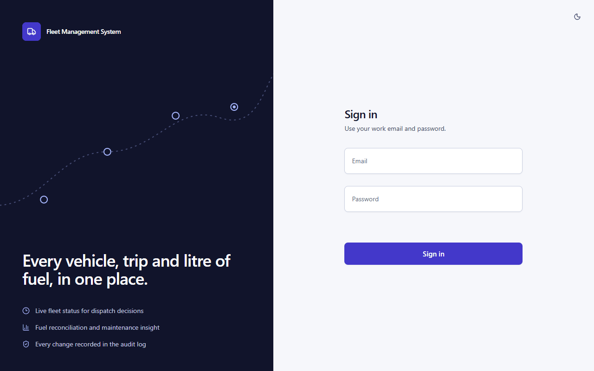

You stay signed in on that browser for up to 7 days of use. To sign out, select the **sign-out arrow** on your account
card, at the bottom of the menu (on a phone, select your initials at the top right, then **Sign out**).

**Your first sign-in.** You don't choose your own account. An administrator invites you, and you receive a one-time
link.

1. Open the link. It opens the **Set password** page.
2. Choose a password of **at least 12 characters**. It may not contain your email address, nor be one character
   repeated.
3. Confirm it. You are then signed in.

The link works once and lasts 72 hours. If it has expired, ask your administrator for a new one. **Forgotten your
password?** Ask your administrator for a reset link. A reset link lasts 1 hour, and setting a new password signs you
out everywhere else.

### Finding your way

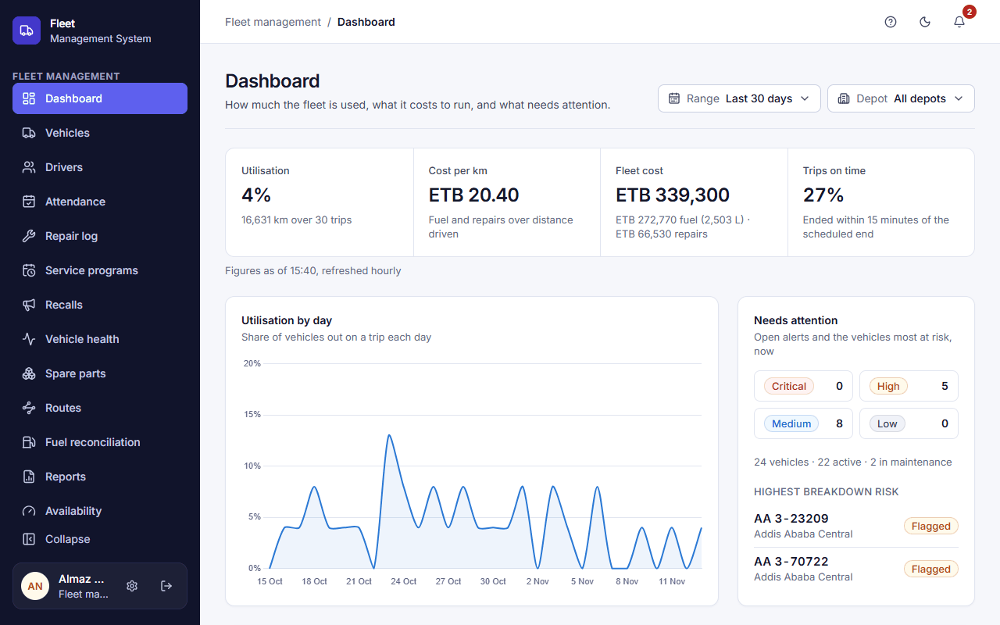

- **The menu** (left) lists only the screens you may use, grouped as *Fleet management*, *Command center* and
  *Administration*. If a colleague sees a screen that you don't, it is because of your role. **Collapse** at the
  bottom turns the menu into icons.
- **The top bar** shows where you are (for example *Fleet management / Dashboard*), and three buttons: **?** for help,
  the **moon** for the dark theme, and the **bell** for your notifications.
- **Your account card** (bottom of the menu) shows your name and role. The **gear** opens your notification settings;
  the **arrow** signs you out.
- **On a tablet** the menu shrinks to icons; **on a phone** it opens from the menu button. Every screen works at phone
  width.
- **Tables** can be searched, filtered with the tabs above them, sorted by a column heading, and paged at the bottom.
  **Table options** chooses the columns, and **Saved views** keeps a filter you use often.

**Units.** Times are Addis Ababa time. Money is in birr (ETB), fuel in litres, distance in kilometres.

### Notifications

The **bell** shows how many notifications you haven't read. Select it to see the last 30 days of them, newest first.
Select one to open the screen it is about (a vehicle, a trip, an anomaly). **Mark all as read** clears the count.

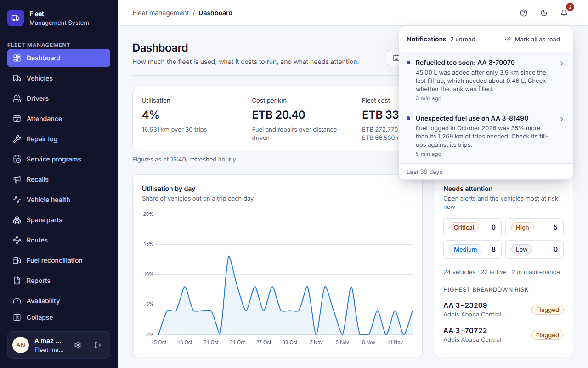

What reaches you depends on your role. For example:

- a driver's inspection problem reaches the technicians and the depot admin;
- a fuel anomaly reaches the finance office and the fleet manager;
- an expiring licence reaches the depot admin and the driver.

**Choose how alerts reach you:** select the **gear** on your account card to open **Notification settings**. Alerts
always appear in FMS. Critical alerts can also come by email, SMS and push, and high ones by push. From this page you
can also turn on push notifications for this browser and send yourself a test.

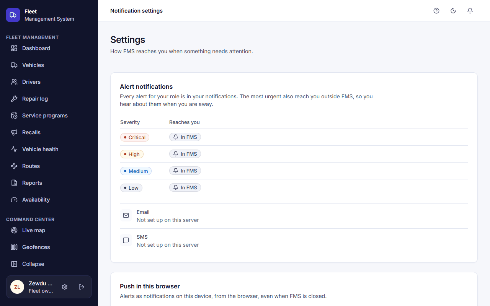

### Light and dark

FMS follows your device's light or dark setting. The **moon** button in the top bar switches it for this browser.

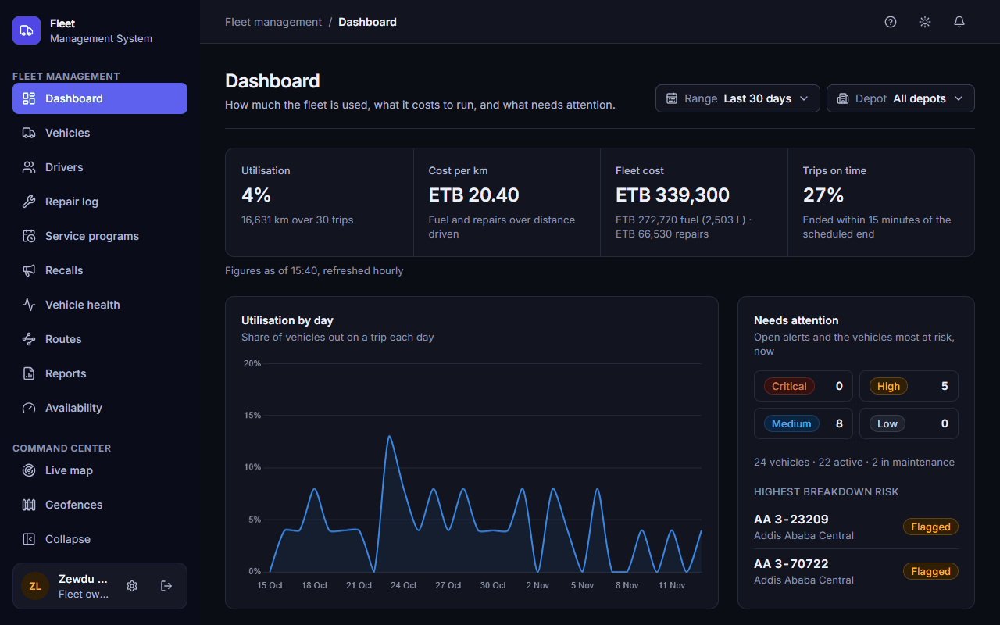

## How the roles work together

Most of what happens in FMS passes from one role to the next. A typical day for one vehicle:

| Step | Who | What happens in FMS |
|---|---|---|
| 1 | Dispatcher | Creates a trip and assigns a driver and a vehicle. FMS refuses a driver or vehicle who is busy, unqualified or flagged |
| 2 | Driver | Sees the trip on *My day*, inspects the vehicle before leaving, and reports a problem with the brakes |
| 3 | FMS | Flags the vehicle for maintenance: it can't start a trip or be assigned to one, and the technicians are alerted |
| 4 | Technician | Repairs it, records what failed and the parts used, and completes the job. The flag clears |
| 5 | Driver | Starts the trip. Their phone shares the vehicle's position for as long as the trip is under way |
| 6 | Dispatcher | Follows the vehicle on the live map |
| 7 | Driver | Logs fuel on the way, reports a road hazard, ends the trip and inspects the vehicle again |
| 8 | Finance Clerk | At the month's end, checks the fuel logged against what the trips needed |
| 9 | Managers, Compliance | See it all on the dashboard and reports; every change is in the audit log |

The sections below follow this day.

## Driver

You use FMS on your phone, in the **FMS Driver** app. It shows today's trips, and is where you start and end them,
inspect your vehicle, log fuel, report incidents and check in at the depot. It keeps working where there is no signal.

### Install the app

Open FMS in your phone's browser (Chrome on Android) and sign in. A card offers **Install FMS Driver**: select
**Install**, and the app appears on your home screen like any other. Select **×** if you would rather not.

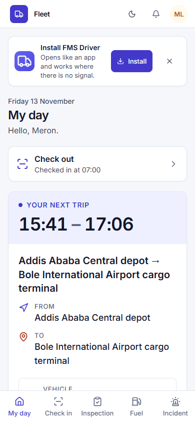

The tabs along the bottom are **My day**, **Check in**, **Inspection**, **Fuel** and **Incident**.

### Check in at the depot

When you arrive, check in at the screen by the depot gate:

1. Open the **Check in** tab, or select **Check in** on *My day*.
2. Select **Scan depot code**. The camera opens.
3. Point it at the QR code on the depot's screen. FMS records your arrival and tells you whether you are on time or
   late.
4. When you leave, do the same with **Scan to check out**.

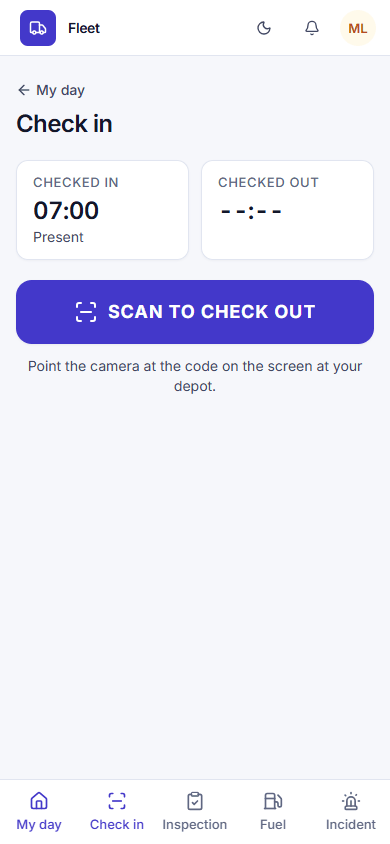

The code changes every 30 seconds, so it can only be scanned at the depot. If your camera is blocked or your phone has
no signal, ask your supervisor, who can record your arrival by hand.

### Your day, step by step

#### 1. See your next trip

**My day** shows the trip under way, or your next trip today:

- the time it leaves and is due back;
- where it goes from and to;
- the vehicle's plate;
- the buttons you need next.

Later trips today are listed below it.

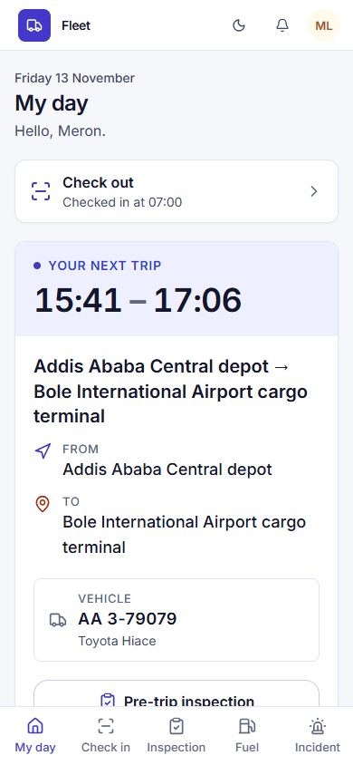

#### 2. Inspect the vehicle before you leave

1. Select **Pre-trip inspection**.
2. For each item (tyres, brakes, lights and indicators, windscreen and mirrors, horn, fuel level, engine oil, coolant,
   fire extinguisher, first aid kit), select **OK** or **Problem**.
3. For a problem, write what is wrong in the box that appears.
4. Select **Submit inspection**.

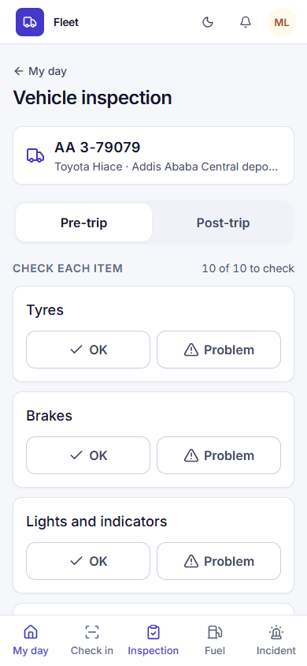

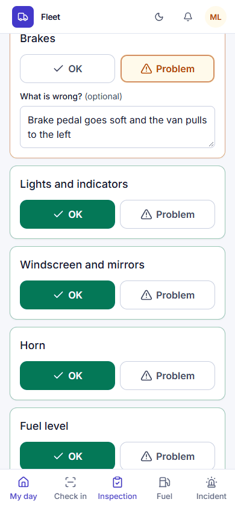

If you report a problem, FMS **flags the vehicle for maintenance**. The technicians are told at once, and the screen
says not to drive the vehicle until dispatch says so.

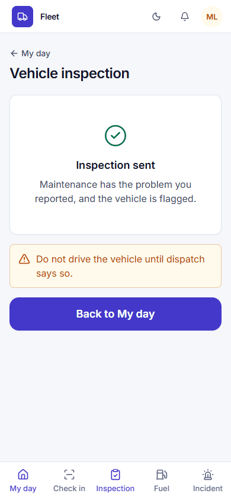

While a vehicle is flagged, **START TRIP** is refused, with the reason underneath. Call dispatch: they will give you
another vehicle or wait for the repair.

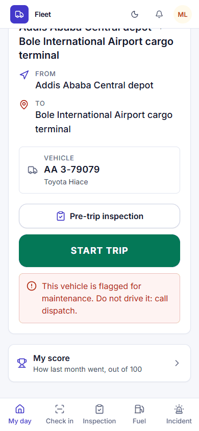

#### 3. Start the trip

Once the vehicle is cleared, select **START TRIP**. The card turns to **On the road**, with the time you started.

The first time, your phone asks whether FMS may use your location: allow it. While the trip is under way **your phone
is the vehicle's GPS**, and the card says *Sharing your location with dispatch*. If location is blocked, a banner says
so on every tab, with **Try again**.

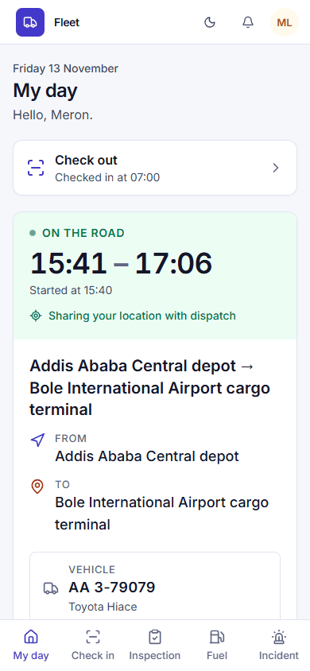

If the trip has stops, they are listed in order. Select **Done** at each one as you complete it.

#### 4. Log fuel

When you fill up:

1. Open the **Fuel** tab. It is for your trip's vehicle.
2. Enter the **litres**, the **total paid** (FMS shows the price per litre), the **odometer** reading and, if you
   like, the **station**.
3. Select **Log fuel**. *Fuel logged* confirms what was recorded.

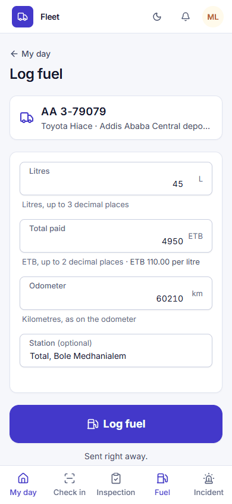

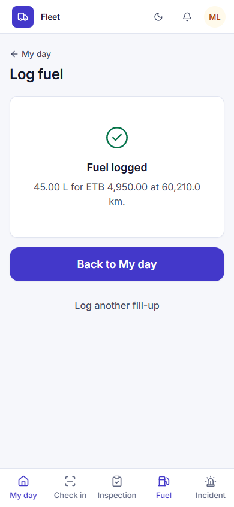

The fill-up keeps the time you pressed the button, even if it is sent later. The odometer can't be lower than the
vehicle's last reading: if FMS refuses it, check the number and send it again.

#### 5. Report an incident

For an accident, a breakdown, a flat tyre, theft, vandalism, an injury or a hazard on the road:

1. Open the **Incident** tab.
2. Choose **what happened** and **how serious** it is: *Minor*, *Moderate*, *Serious* or *Critical*. Choose
   *Critical* when the vehicle must not be driven or someone is hurt: dispatch is alerted straight away.
3. Describe it, and select **Add my location** if you can.
4. Select **Send report**.

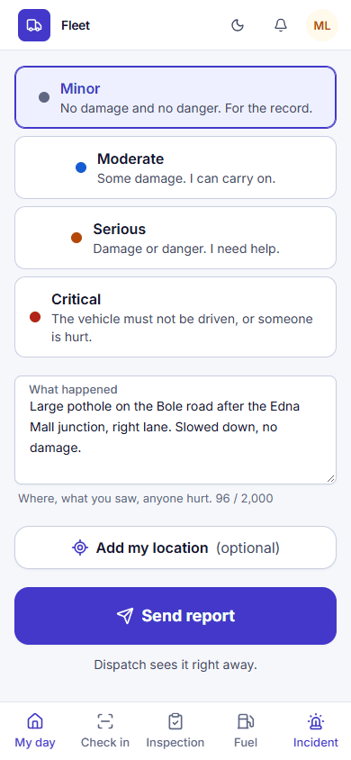

Dispatch sees the report on the live map and follows it up.

#### 6. End the trip and inspect again

When you arrive, select **END TRIP**. FMS then asks for the **post-trip inspection**: tyres, brakes, lights, body
damage, leaks, warning lights, fuel level, cabin.

1. Select **Start post-trip inspection**.
2. Mark each item.
3. Select **Submit inspection**.

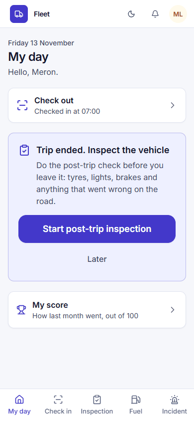

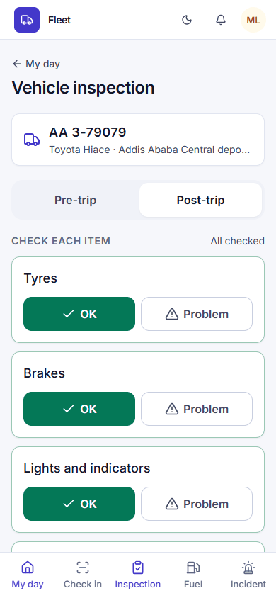

### With no signal

FMS keeps working where there is no network:

- **My day** shows your trips as they were last saved on the phone, with the time they were saved.
- **Inspections, fuel and incidents** are kept on the phone and sent on their own, in order, once the signal returns.
  A badge at the top shows how many are waiting. Select it to see them, or **Send now** once you have signal.
- **START TRIP and END TRIP** need signal, because the server records the time. They wait until you have it.
- **Your positions** are kept on the phone and sent when the signal returns.

Up to 50 submissions can wait on the phone. If one is refused (for example, an odometer lower than the last reading),
the list marks it **Not sent** with the reason. Remove it, then send it again corrected.

### Your score

**My score** on *My day* shows how last month went, out of 100; the arrows move to another month. A month needs at
least 3 completed trips for a score. It is made of four parts, each with its weight and explained on the page:

- **On time:** trips ended within 15 minutes of their schedule.
- **Safe driving:** speeding and idling alerts for the distance driven.
- **No accidents.**
- **Inspections:** trips inspected before setting off.

Only you and your managers see it.

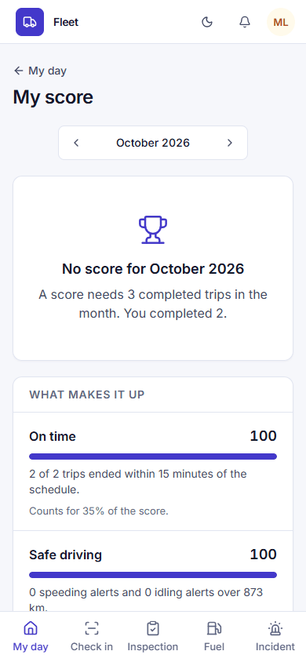

## Dispatcher

You staff your depot's trips: you create them, give each one a driver and a vehicle who are free and allowed to do it,
and follow them on the live map. Your menu: Dashboard, Vehicles, Drivers, Attendance, Routes, Reports, **Dispatch**,
**Live map** and Geofences.

### The Dispatch console

**Dispatch** opens on today's and upcoming trips:

- **On the left**, the trips, in three tabs: **Unassigned**, **Assigned** and **Under way**.
- **On the right**, the assignment panel, then the depot's drivers and vehicles, each with its state now:
  - **Drivers:** green *Available*, amber *Finishing a trip*, red *On a trip*, grey *Absent*.
  - **Vehicles:** green *Available*, red *Flagged*, grey *On a trip*.

The console refreshes itself (*Live · Updated* at the top). Each trip card shows its **job load**: *Light*, *Standard*
or *Heavy job*, from its distance, its hours and what it carries.

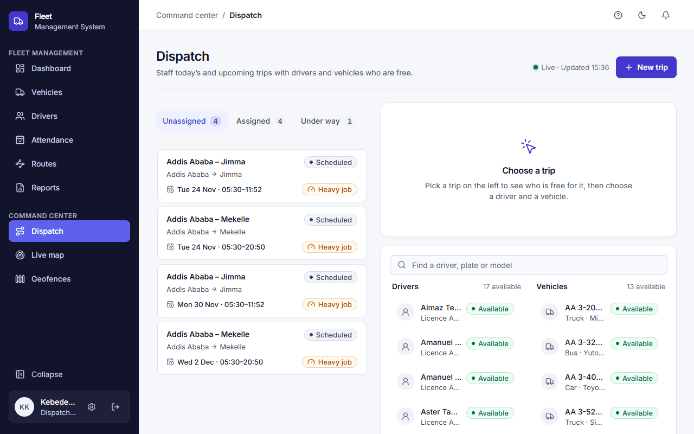

### Create a trip

1. Select **New trip**.
2. Choose **Saved route** (one of the depot's planned routes) or **One-off trip**. For a one-off trip, name where it
   goes from and to, with their coordinates if you have them.
3. Enter when it **leaves**, and when it is **back by**. A saved route's estimated time fills *Back by* if you leave it
   blank.
4. Say what it **carries** (general goods, fragile, hazardous, refrigerated, passengers) and, if you know it, the
   **weight**.
5. Select **Create trip**. It appears under **Unassigned**.

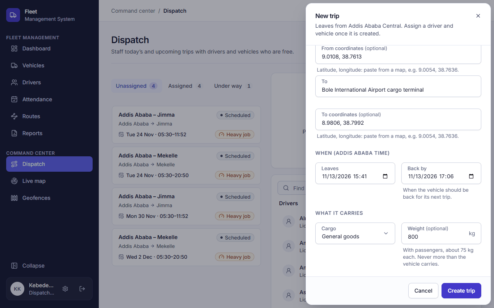

### Assign a driver and a vehicle

1. Select the trip on the left. The panel shows it, and the lists mark who and what is **free for that trip**.
2. Select a **driver**. Only those free at that time, with a valid licence for the vehicle, are offered as free. Each
   shows how much of their daily and weekly driving limit the trip leaves (for example *180 km left today · 900 this
   week*); one the trip would take past a limit is marked in red.
3. Select a **vehicle**. A vehicle due for service says so; a flagged one shows its open work order.
4. Select **Assign**.

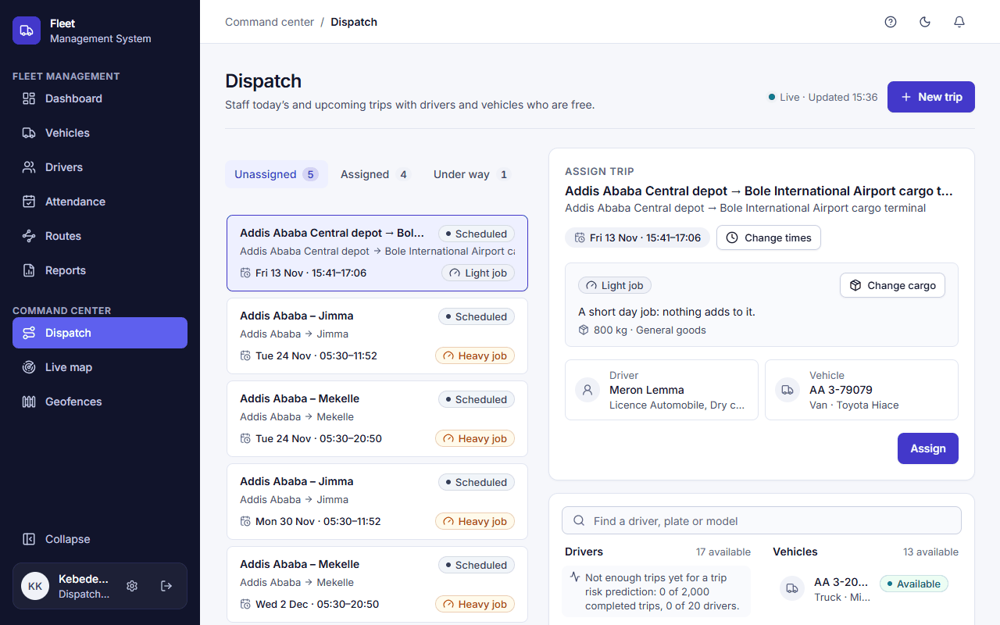

**The trip risk hint.** Under each free driver, FMS can show the chance they run late on this trip, and of a safety
event, with the two things that raise it most. It is advice: it never blocks anyone or changes the order of the list.
While the model has learnt from generated trips rather than your fleet's, a note says so. Until your fleet has enough
completed trips, the note says *Not enough trips yet*.

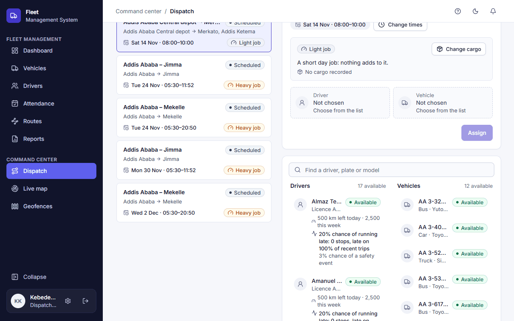

The trip moves to **Assigned** and appears on the driver's phone.

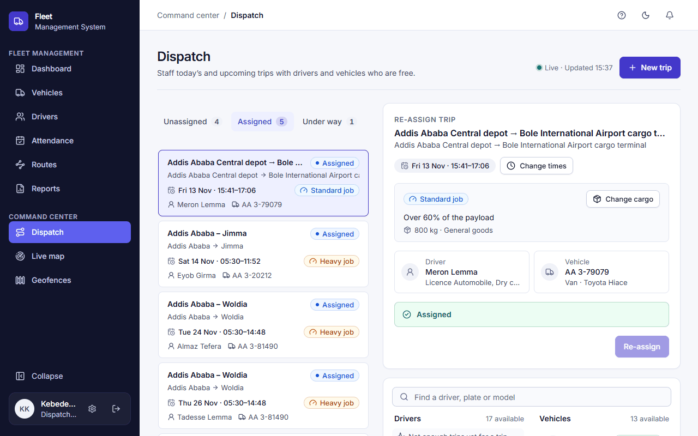

**When FMS refuses.** The reason appears in the panel. FMS refuses to assign when:

- the driver or vehicle is on another trip at that time (with that trip named);
- the vehicle is flagged for maintenance;
- the licence has expired or doesn't cover the vehicle;
- the trip would take the driver past a driving limit.

These can't be overridden: choose someone or something else. Some warnings, such as a driver marked absent today or a
previous trip running late, can be set to need a fleet manager's approval. The panel then asks why, and the trip shows
**Awaiting approval** until a fleet manager decides.

**Changing a trip.** **Change times** moves an assigned trip, and asks why. If the new time runs into the driver's or
vehicle's next trip, FMS offers to move that one later. **Change cargo** changes what it carries before it starts.

### Follow trips on the live map

**Live map** (the Fleet Command Center) shows:

- every vehicle on the map, coloured by state: moving or stopped, idling 5 minutes or more, speeding, breakdown, or no
  ping for 2 minutes;
- counters above it: vehicles, drivers, today's trips, what needs attention;
- beside it, the **Fleet** list (with **On trip**, **Attention** and **All**), the **Alerts** and the **Incidents**.

It updates live.

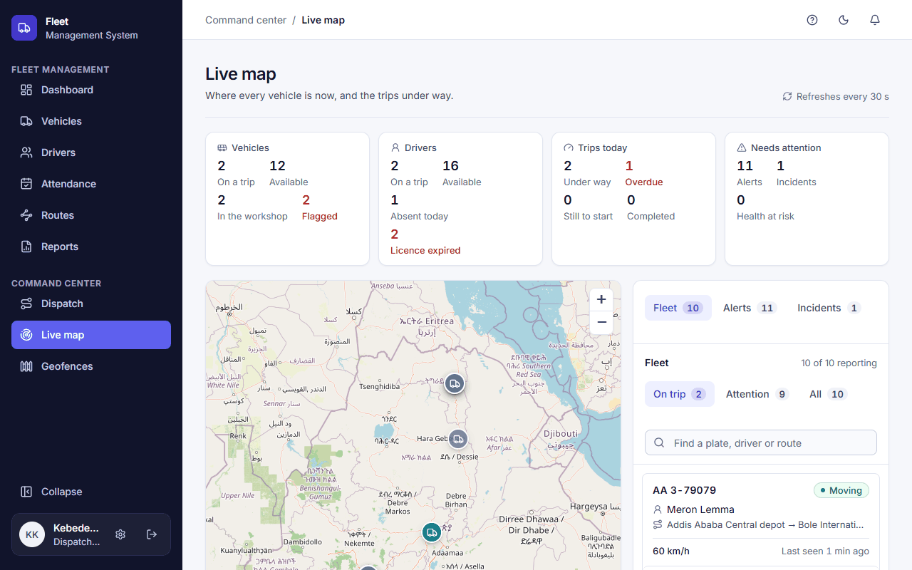

**Focus on driver**, under a vehicle, follows that one vehicle with its trip's planned route and today's GPS track.
**Whole fleet**, or Esc, returns to every vehicle.

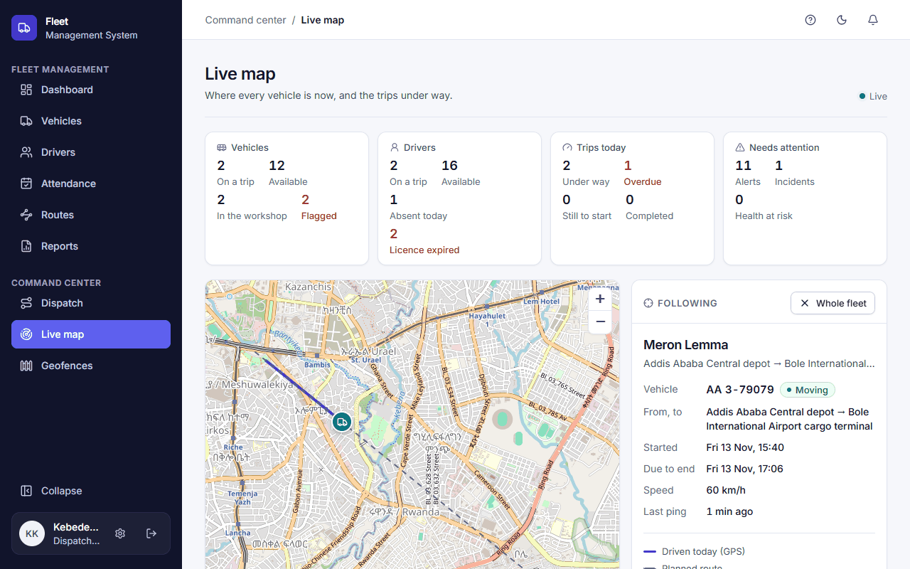

The **Alerts** and **Incidents** tabs beside the map list what needs attention. Acknowledge or resolve an alert there.
Select an incident a driver reported to take it on, change its status or add notes.

On the console, a trip **Under way** shows its arrival estimate and next stop.

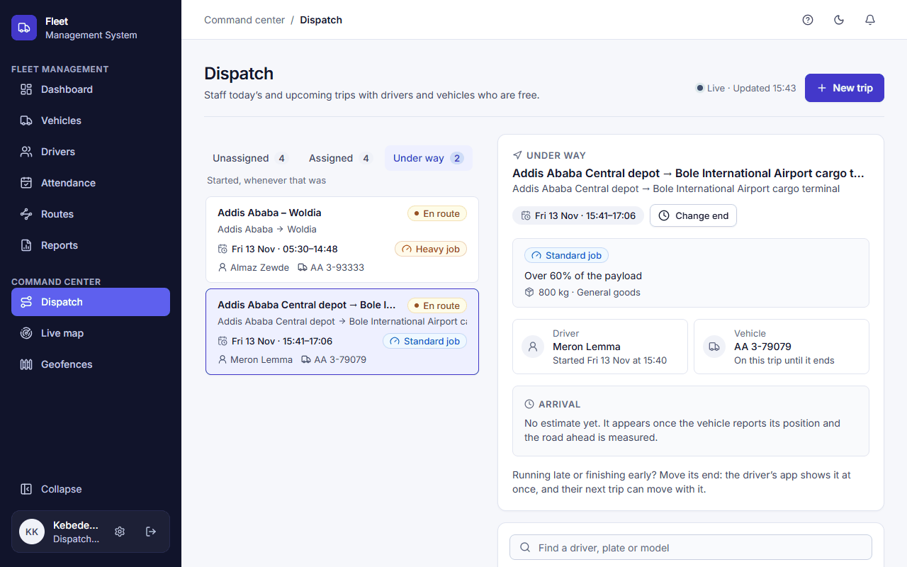

### Other things you do

- **Drivers and Vehicles:** read who and what your depot has, with licences, documents and status.
- **Attendance:** see who is in today. Show the **Check-in code** on a screen at the gate for drivers to scan.
- **Routes:** add and edit the depot's planned routes.
- **Reports:** the monthly trip history and driver performance, among others.

## Maintenance Technician

You keep vehicles safe and working. You repair those flagged by a driver's inspection or by the health model, log
every job with its parts and cost, and keep up preventive service. Your menu: Dashboard, Vehicles, **Repair log**,
Service programs, Recalls, **Vehicle health** and **Spare parts**.

### The repair log

**Repair log** lists every repair, inspection and service, open work first. Each shows its vehicle, the work, status,
parts and total. The tabs are **Open work**, **Completed**, **All** and **Service due**. **Flagged vehicles** and
**Parts to reorder** show how many need you.

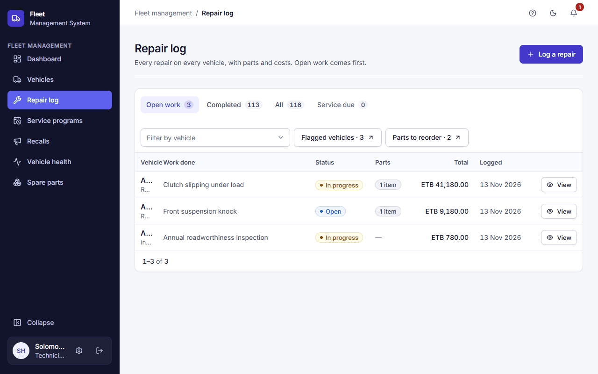

When a driver reports a problem, you get a notification, and the vehicle appears under **Flagged vehicles**.

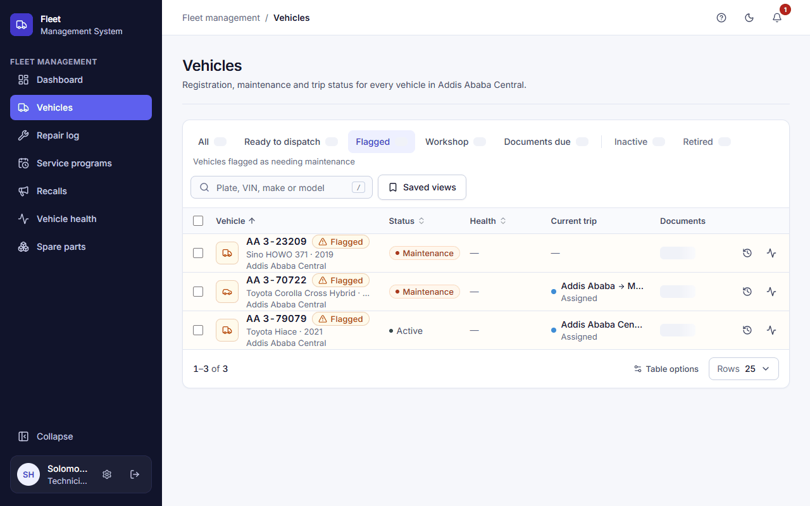

### Repair a flagged vehicle

1. Select **Log a repair**.
2. Choose the **vehicle**. Flagged vehicles are listed first; type a plate to find any other.
3. Choose the **type of work** (*Repair*, *Preventive service*, *Inspection*, *Predictive (AI flagged)*, *Other*), the
   **labour** in hours, and describe the **work done**.
4. Under **What failed**, choose the **component** (brakes, engine, tyres, ...) and the **failure mode** (worn out,
   leak, broken, ...). Say whether it broke down in service or was found at planned work, and **how it was found**
   (here, *Driver inspection (DVIR)*). A repair can't be completed without at least one failure: this history is what
   the health predictions learn from.
5. Under **Parts used**, select **Add part** for each part taken from stock. Stock goes down when you save.
6. Enter the **total cost**.

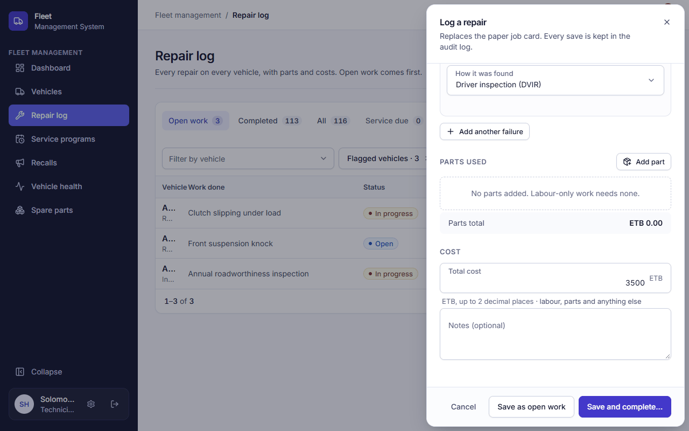

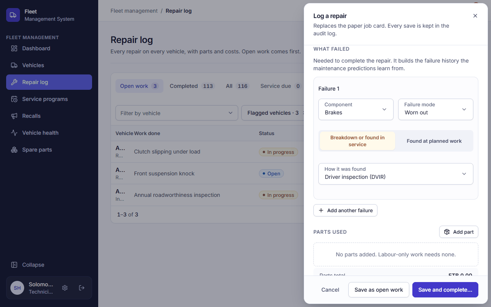

1. To finish now, select **Save and complete…**. To come back to it, select **Save as open work**.
2. FMS asks you to confirm. Completing clears the vehicle's maintenance flag if this was its last open job, and the
   vehicle becomes available for dispatch again.

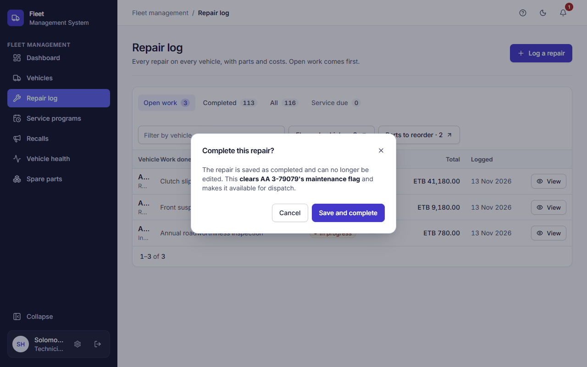

The repair moves to **Completed**. A completed repair can't be edited; to correct one, log a correction from it.

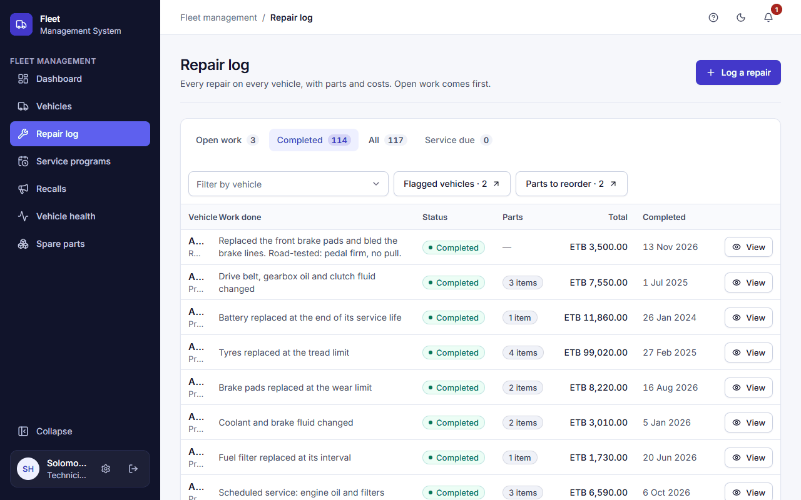

### Vehicle health

**Vehicle health** shows every vehicle's predicted **health score**, from 0 to 100, with the factors that lower it most
(for example kilometres since the last brake-pad change). The **At risk** tab lists those likely to fail in the next 30
days. Scores are worked out every night.

For an at-risk vehicle, open it, inspect it, and record what you found: **Schedule inspection** books it.

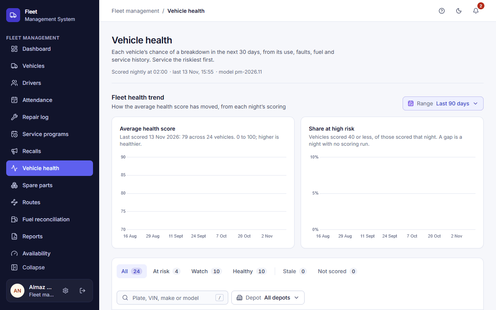

### Preventive service, recalls and parts

- **Service due** (a tab of the repair log) lists vehicles due or overdue under their service programs. **Log service**
  opens the repair form as preventive work, and completing it restarts the program's count.
- **Recalls** lists manufacturers' recalls and your vehicles under them. **Mark done** records a remedy.
- **Spare parts** shows the stock, with *Low* and *Out of stock* marked. **Adjust** corrects a count, and **Stock
  history** shows every movement.

## Depot Admin

You keep your depot in order: its drivers and their licences, who is in each day, its vehicles and documents, and its
spare parts. Your menu: Vehicles, Drivers, **Attendance**, Repair log, Service programs, Recalls, Vehicle health,
**Spare parts**, Routes, Fuel reconciliation, Live map and Geofences.

Your Dashboard is a placeholder for now: start from the menu.

### Attendance

**Attendance** shows today's roster, one card per driver: **Present**, **Absent** or **On leave**, and their check-in
and check-out times, each marked *QR scan* or by hand. Late arrivals are marked *Late*. The arrows and the date move to
another day. The tabs count each state.

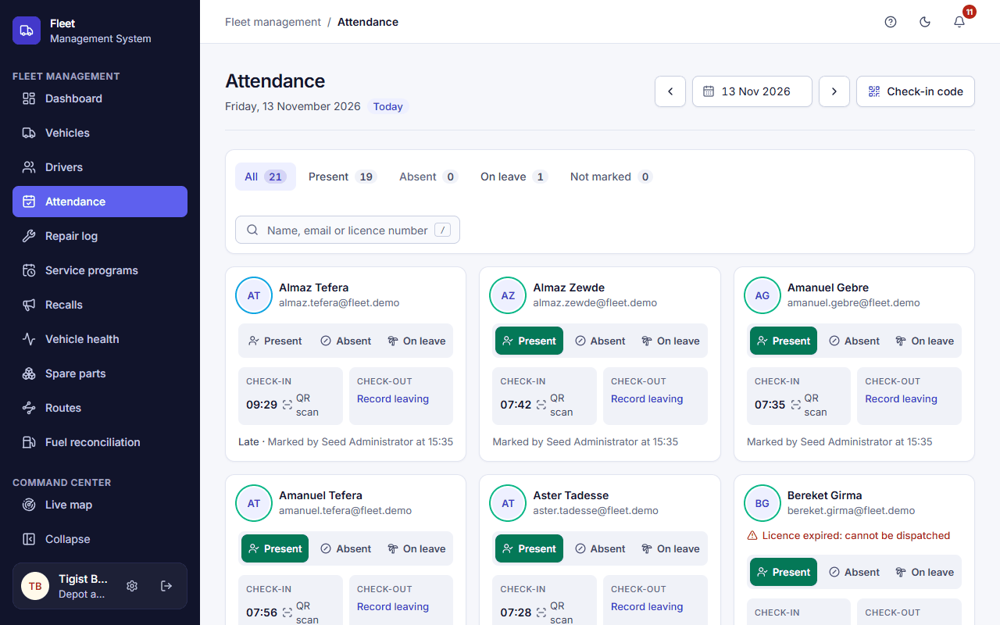

To mark a driver, select **Present**, **Absent** or **On leave** on their card. For a driver whose phone has no
signal, **Record leaving** (or arriving) records the time by hand, now.

**The check-in code.** Select **Check-in code** and leave it open on a screen at the depot gate. **Full screen** fills
the screen. Drivers scan it with the app to check in and out. The code changes every 30 seconds, so a photo of it is
useless a minute later.

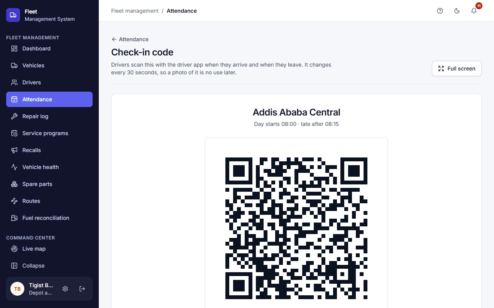

### Drivers and their licences

**Drivers** lists your depot's drivers with their licence classes and expiry. The tabs pick out **Valid**,
**Expiring soon** and **Expired**. A driver with an expired licence can't be dispatched until you record the renewed
one.

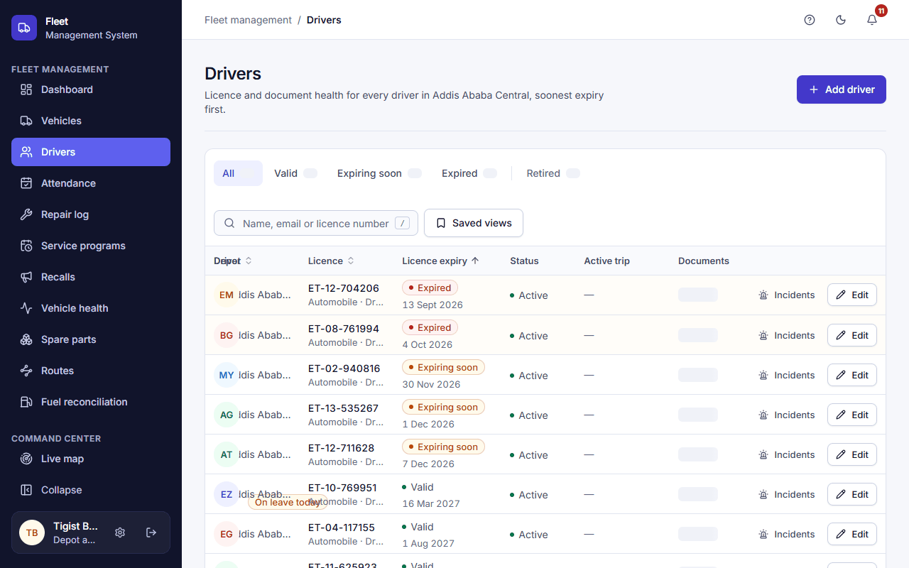

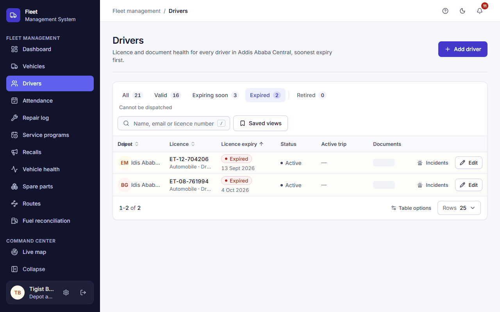

**Add driver** or **Edit** records a driver's licence number, its classes (Ethiopian classes, grouped, each with what
it covers) and expiry, and their photo. Each driver's **Incidents** shows the incidents they were involved in.

### Vehicles and documents

**Vehicles** lists the depot's vehicles with status, health, current trip and documents. **Documents due** picks out
insurance and registrations expiring soon. Open a vehicle's **History** to upload a renewed document.

### Spare parts

**Spare parts** shows what is in stock, with **Needs reorder**, **Out of stock** and **Low** picked out. **Adjust**
corrects a count after a stocktake, with a reason, and **Stock history** shows every movement.

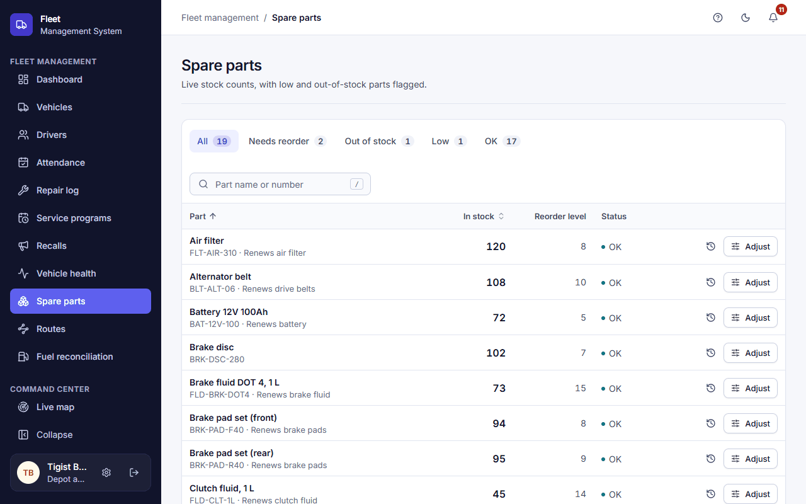

## Fleet Manager

You run the fleet across every depot: you watch performance and cost, decide the exceptions dispatchers can't, keep
vehicles and routes up to date, and report to the owner. You see every staff screen except the audit log.

### The dashboard

**Dashboard** answers three questions: how much the fleet is used, what it costs, and what needs attention.

- **The KPI band:** utilisation, cost per km, fleet cost (fuel and repairs), trips on time.
- **The charts:** utilisation by day, cost by day (fuel and repairs), utilisation by vehicle.
- **Needs attention:** open alerts by severity, the fleet's average health, and the vehicles most at risk of breaking
  down, with each one's chance.
- **Driver ranking:** last month's drivers, scored 0 to 100 on punctuality, safety, incidents and inspections. **Full
  list** shows every driver.

Choose the **range** (7, 30 or 90 days, or 12 months) and the **depot** at the top right. The figures are refreshed
hourly; a banner says when they are older than a day.

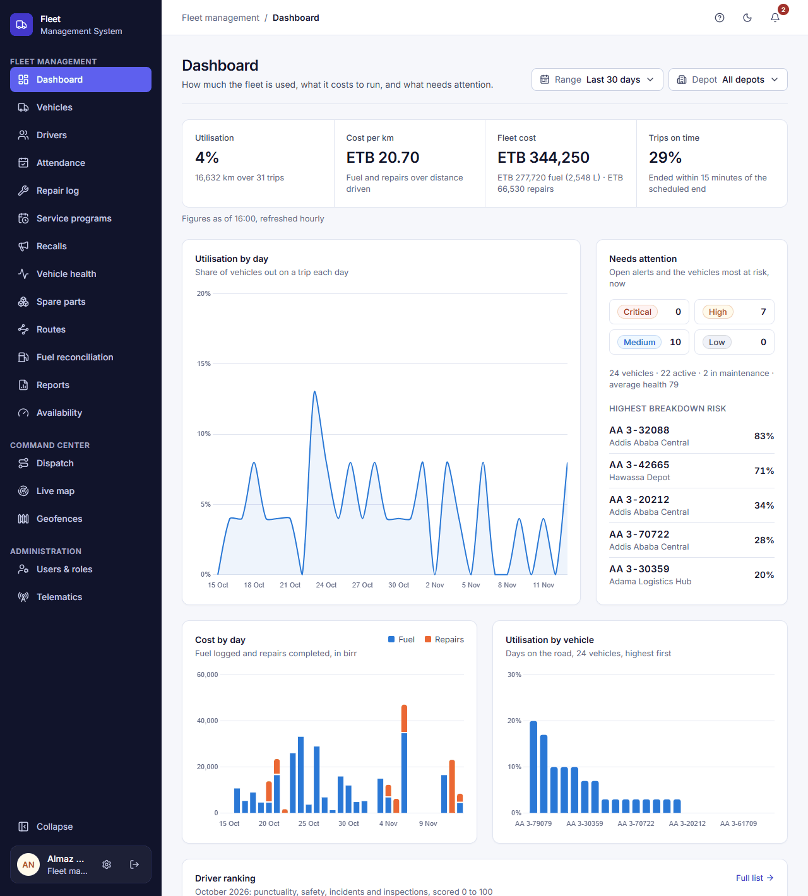

### Vehicles and their history

**Vehicles** lists every vehicle, with tabs for **Ready to dispatch**, **Flagged**, **Workshop**, **Documents due**,
**Inactive** and **Retired**. **Add vehicle** registers one: its plate, VIN, make and model, fuel, payload, and what
it is built to carry for the licence check.

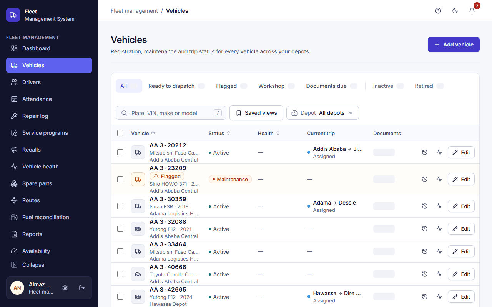

Select a vehicle's **History** icon for its whole life in one page:

- **The header:** plate, model, status, flag, health, odometer, fuel use and its trip now.
- **The sections:** Repairs, Trips and routes, Fuel and odometer, Documents, Health, Service due, Warranty and recalls,
  and Incidents.

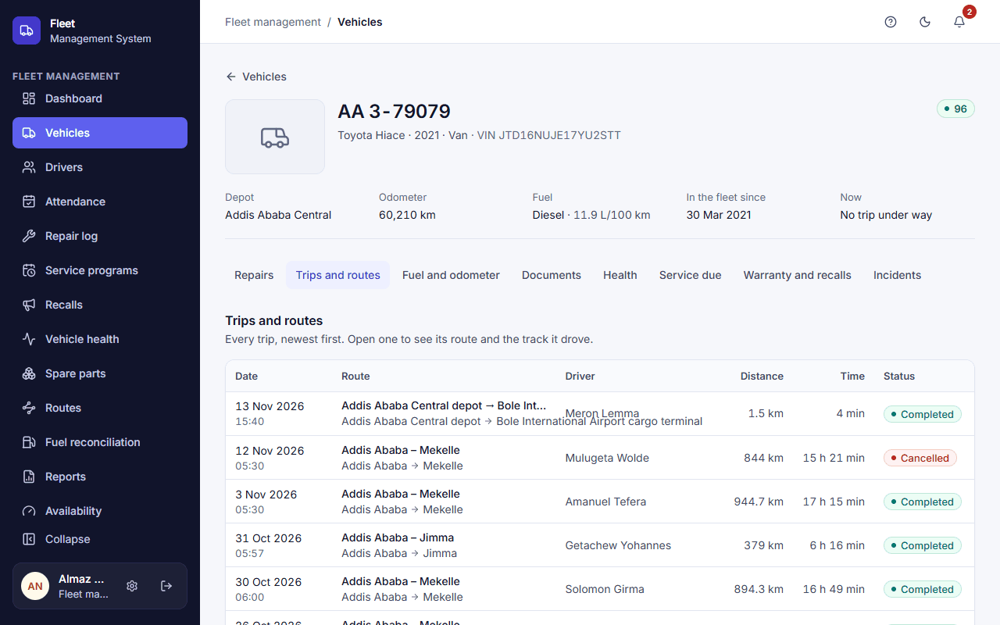

In **Trips and routes**, selecting a trip shows the route it drove on a map. **Replay** moves the vehicle along it.

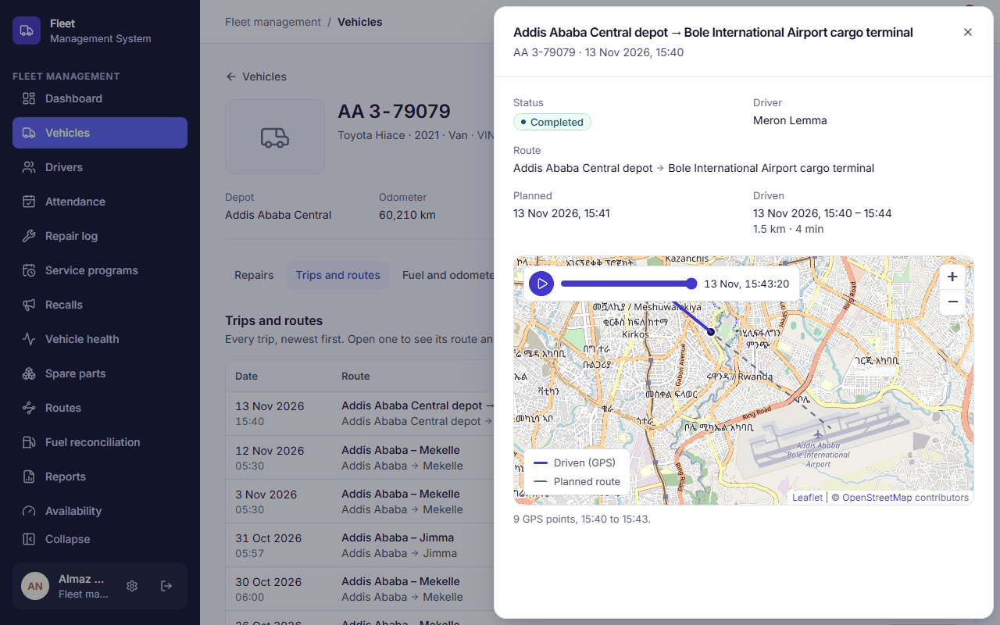

### Approve exceptions

Where a depot is set to need approval for an absent driver or a previous trip running late, the dispatcher's request
comes to you as a notification. Open the trip on **Dispatch**: the panel shows the request and the reason.

- **Approve and assign** assigns the trip, after FMS checks every rule again.
- **Refuse** sends it back with your reason, which the dispatcher sees as *Approval refused*.

Nobody decides on their own request.

### Reports and availability

**Reports** builds the monthly reports for management: **Fuel**, **Maintenance**, **Cost**, **Trip history** and
**Driver performance**. Choose the month (last month by default) and the depot. You get a preview with a totals row,
and **Download CSV** or **Download PDF** saves the file.

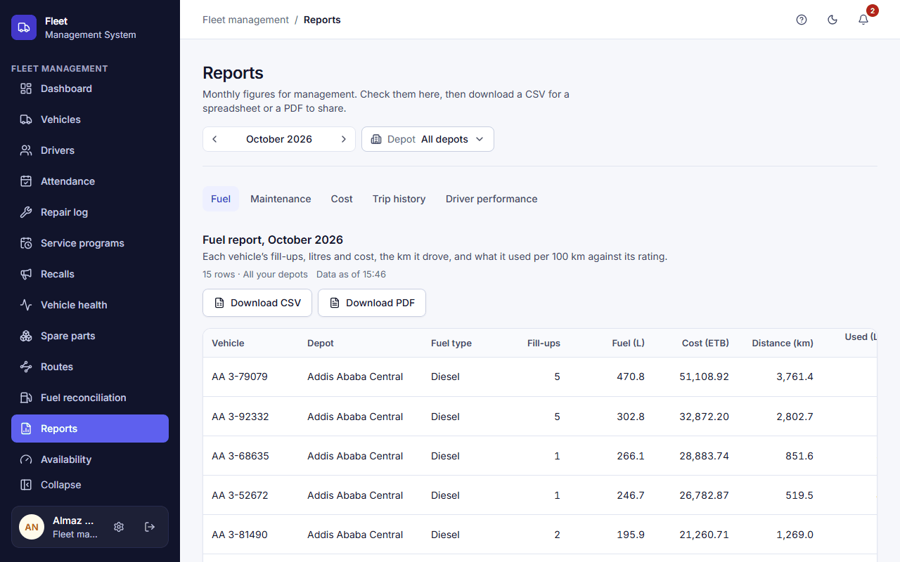

**Availability** shows how much of a month the vehicles could work: availability, downtime, mean time between
failures (MTBF) and to repair (MTTR), downtime by reason, the depots side by side, and every vehicle, most downtime
first. Select a vehicle to see its downtime periods and what caused them. **Export CSV** saves it.

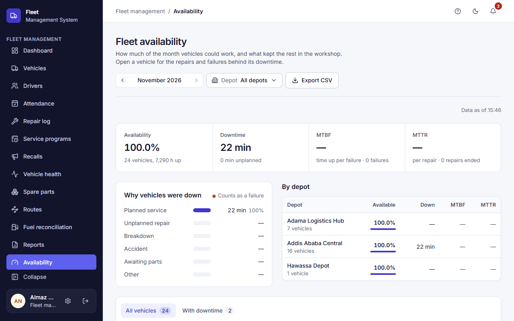

### Also yours

- **Routes:** each depot's planned routes.
- **Service programs:** preventive service schedules, in kilometres, days or engine hours, whichever comes first.
- **Geofences:** the yards and no-go zones on the map (an admin draws them).
- **Users & roles:** read who has which role.
- **Telematics:** link tracking devices to vehicles.

## Finance Clerk

You check that the fuel the company pays for matches the driving it was used for, close the anomalies, and export the
figures. Your menu: Dashboard, **Fuel reconciliation** and **Reports**.

### Reconcile a month's fuel

**Fuel reconciliation** opens on last month. The summary band shows:

- the **fuel logged**, in litres and fill-ups;
- the **fuel cost**;
- how far it is **against what the trips needed**, at each vehicle's rated consumption;
- how many vehicles are **flagged**.

Below it, every vehicle with trips or fill-ups that month, furthest off first: the trips driven, the litres they
needed, the litres logged, the **variance** and the cost. **Export CSV** saves the table.

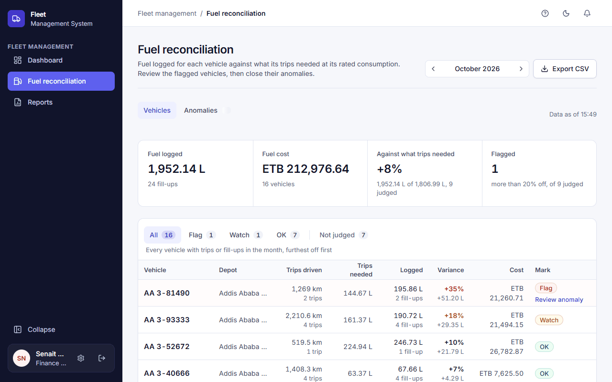

Each vehicle has a **mark**:

| Mark | Means |
|---|---|
| **Flag** (red) | More than 20% off, either way. A fuel anomaly is opened |
| **Watch** (amber) | More than 10% off |
| **OK** (green) | Within 10% |
| **Not judged** (grey) | Electric, no rated consumption, or under 100 km of trips. The reason is shown |

The 20% threshold is a setting the admin can change. **Data as of** says how current the figures are.

### Close an anomaly

1. Select **Review anomaly** on a flagged vehicle, or open the **Anomalies** tab.
2. Check the vehicle's fill-ups against its trips.
3. Choose **Resolved** (it was real and has been dealt with) or **Not a problem** (the fuel is explained).
4. Add a note saying what you found.
5. Select **Mark resolved** (or **Dismiss**).

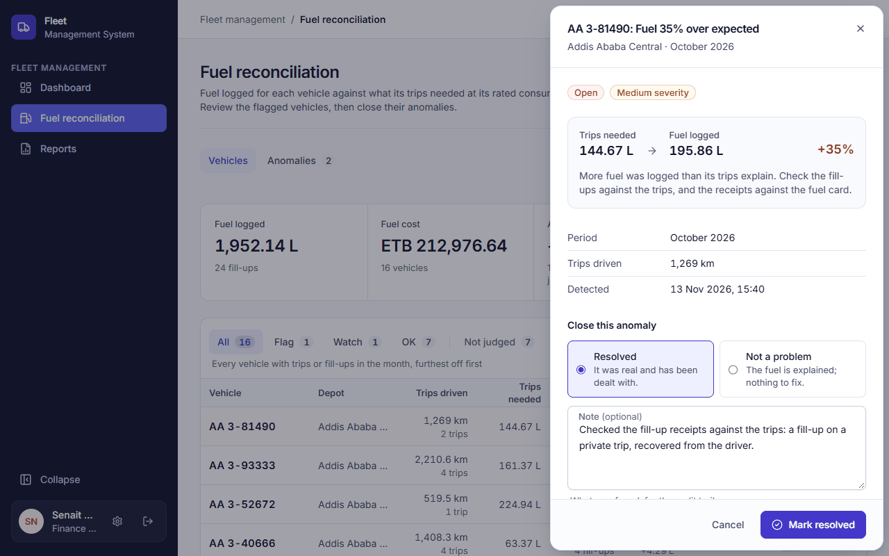

FMS records who closed it, when, and your note. The **Anomalies** tab lists them, open first.

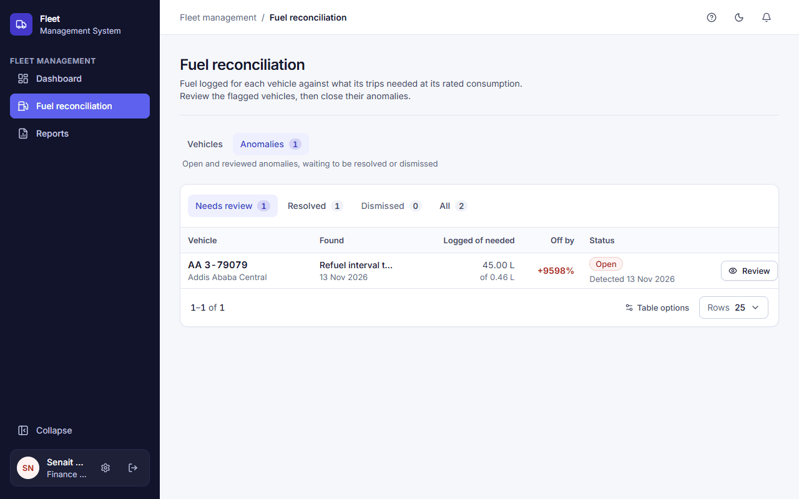

Single fill-ups are checked too, the moment they are logged: one too soon after the last, a price per litre outside
the expected band, or a fill-up far from where the vehicle's GPS had it.

### Reports

**Reports** gives the monthly **Fuel** and **Cost** reports (and the others) as **CSV** for the accounts, or **PDF**
for management.

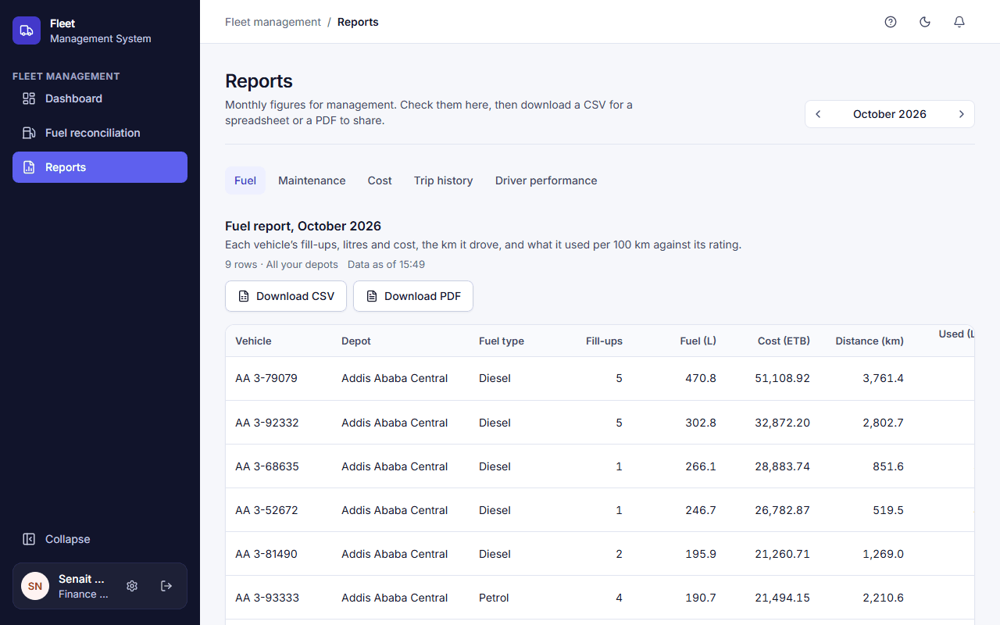

## Compliance Officer

You check that the fleet follows the rules: who changed what, licence and document expiries, driving violations, and
how anomalies were handled. You can read most screens, and change nothing in them.

### The audit log

**Audit log** records every change to FMS's records as it happens: who, what, when and from where. Nobody can edit it,
not even an admin.

- **Data changes:** records created, updated or deleted, and role changes.
- **Sign-ins:** successful and failed sign-ins.
- **Denied:** requests refused for lack of permission.
- **Scheduled jobs:** the nightly checks and imports.
- **Everything:** all of these together.

Find a record by its ID, or filter by **kind of record** and **period**.

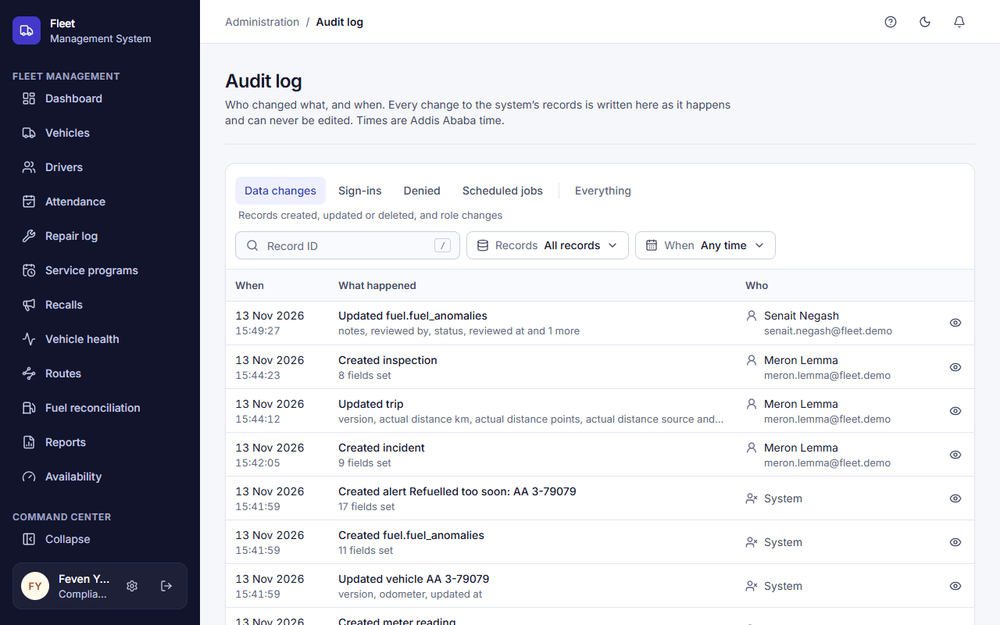

Select an entry's **eye** to see exactly which fields changed, before and after. From there, follow **Everything they
did**, **Its full history** or **Everything in it** (the whole request) to see the related entries.

### What else to check

- **Drivers:** the **Expired** and **Expiring soon** tabs.
- **Vehicles:** **Documents due**.
- **Fuel reconciliation:** the anomalies, and who closed them and why.
- **Users & roles:** who holds which role. Every role change is also in the audit log.
- **Reports and Availability:** for audits and reviews.

## Fleet Owner

You see how the business is doing, across every depot, read-only: the dashboard, availability, vehicles, drivers,
repairs, vehicle health, routes, reports, the live map and the audit log. You also manage the **depots**.

What to look at:

- **Dashboard:** utilisation, cost per km, total fleet cost and trips on time, over 12 months for the trend.
- **Availability:** how much of each month vehicles could work, and why they couldn't.
- **Reports:** the monthly reports, as PDF.
- **Vehicle health:** the vehicles most at risk.

## Admin

You set FMS up and keep it running: people and their roles, depots, the rules' thresholds, backups and the system's
health. You can open every screen.

### Invite a user

1. Open **Users & roles** and select **Invite user**.
2. Under **Person**, enter their **full name**, **work email** and, optionally, their **phone**.
3. Under **Roles**, tick one or more. Each role says what it is for.
4. Under **Access**, choose their **home depot**. Leave it at *None (every depot)* for someone who works across every
   depot; fleet-wide roles see every depot anyway.
5. Select **Create account**. FMS shows a **one-time setup link**, once. Send it to the person; it lasts 72 hours.

Inviting a **driver** then offers **Add driver profile**, for their licence. A driver without one can't be dispatched.

**Managing people.** **Edit** on a user's row changes their roles (only within your own permissions), resets their
password (a new 1-hour link), or **deactivates** them, which signs them out at once. **Roles** lists what each role may
do.

### Depots

**Depots** lists the yards vehicles, drivers and staff belong to. **Add depot** creates one (name, code, location,
capacity), and **Edit** changes it. A depot can be deactivated only once no active vehicle, driver or account remains
in it.

### Settings

**Settings** changes the rules' thresholds, without any code:

- **Driving rules:** the speed limit, how many pings flag and clear speeding, idling minutes. A depot can have its own
  rules.
- **Assigning through a warning:** whether an absent driver, or a previous trip running late, only warns or needs a
  fleet manager's approval.
- **Driving distance limits:** the daily and weekly limits, and how much light, standard and heavy jobs count.
- **Alerts and anomalies:** the fuel variance threshold, the health score's alert line, and how early expiries are
  warned of.

Each shows its default, who changed it last, and **Use the default**. A change takes effect within a minute and is in
the audit log.

### Keeping FMS healthy

- **System health:** each part of FMS (the API, the database and its replica, Redis, the AI service, the outside
  providers), whether it is working now, and its uptime over 24 hours, 7 days and 30 days. Below that are the request
  rate, errors, response times, outages and failed nightly jobs.
- **Backups:** the database is backed up every night and kept 30 days. **Back up now** takes one at once;
  **Download** saves one (the link lasts 5 minutes). Restoring is done by the technical team, never from a button.

The **audit log**, **telematics** devices and **geofences** are yours as well: see the
[Compliance Officer](#compliance-officer) and [Fleet Manager](#fleet-manager) sections.

## Troubleshooting

These are the problems people meet most often, what causes them and what to do.

### 1. "I can't sign in"

- **The email or password is wrong.** Check the email is your work address and Caps Lock is off. Passwords are at
  least 12 characters.
- **Too many attempts.** After 5 wrong tries in 15 minutes, sign-in is paused for that email from that device. Wait 15
  minutes and try again.
- **Your setup or reset link has expired** (72 hours for a setup link, 1 hour for a reset). Ask your admin for a new
  one.
- **Your account is deactivated.** Only an admin can restore it.

### 2. "START TRIP is refused" (drivers)

The reason is shown under the button:

| The message says | Do this |
|---|---|
| The vehicle is flagged for maintenance | Don't drive it. Call dispatch: the vehicle needs a technician first |
| Your licence has expired, or doesn't cover the vehicle | Call your depot admin to record the renewed licence, or dispatch to change the vehicle |
| The button is greyed out | No signal: START and END need the server. Move to where there is signal |

### 3. "The driver or vehicle I want is not free" (dispatchers)

The driver list says why:

| Shown | Means |
|---|---|
| *On a trip*, *Not free then* | Busy at that time |
| *On leave today* | Marked on leave on today's attendance |
| *Licence expired* | Must be renewed first |
| *Would drive 560 of 500 km today* | The trip would take them past their daily (or weekly) driving limit |

A vehicle marked **Flagged** needs its repair completed first. Choose another driver or vehicle, change the trip's
times, or ask the admin about the limits. FMS never overrides these rules.

### 4. "My inspection, fuel log or report hasn't been sent" (drivers)

The badge at the top of the app counts what is **waiting to send**. It goes on its own when the phone has signal, or
select the badge, then **Send now**. If an item says **Not sent**, the server refused it; the reason is shown (for
example an odometer lower than the last reading). Remove it and send it again corrected. Up to 50 items can wait; past
that, get signal before adding more.

### 5. "My location isn't being shared" (drivers)

The banner *Location is blocked: dispatch cannot see your vehicle* means the phone or browser refused FMS your
location. Open the phone's settings, then
the app's (or the browser's) location permission, and set it to *Allow*. Then select **Try again**. Keep the app open
during a trip: phones stop sharing location from apps closed in the background.

### 6. "A screen or button I need is missing"

FMS shows only what your role may do, and only for your depots. A dispatcher of one depot doesn't see another's
trips, and a finance clerk can't open the repair log. If you need more, ask your admin to change your role. A role
change takes effect immediately; sign out and in again if the menu hasn't changed.

### 7. "The numbers look out of date"

The dashboard's figures are refreshed hourly, and a screen tells you how current its data is (*Figures as of ...*,
*Data as of ...*). Fuel anomalies for a month are worked out early on the 1st of the next month. Reload the page for
the latest.

### 8. "I haven't had a notification I expected"

Check the bell: every alert reaches you there first. For email, SMS or push, open **Notification settings** (the gear
on your account card). Check the channels, your email and phone number, and that push is turned on *for this browser*.

## Glossary

| Term | Meaning |
|---|---|
| **Anomaly** | A vehicle's fuel more than the threshold (20%) away from what its trips needed, or a suspicious single fill-up |
| **Assigned** | A trip with a driver and a vehicle, not yet started |
| **Audit log** | The permanent record of every change in FMS: who, what, when |
| **Check-in code** | The QR code on the depot's screen that drivers scan to check in and out |
| **DVIR** | Driver Vehicle Inspection Report: the pre- and post-trip inspection |
| **Flagged** | A vehicle a driver's inspection, or a technician, has marked as needing maintenance. It can't be dispatched |
| **Geofence** | An area on the map: a depot's yard to stay inside, or a zone to keep out of |
| **Health score** | 0 to 100: the predicted chance a vehicle does *not* fail in the next 30 days. Under 75 is at risk |
| **Job load** | Light, standard or heavy, from a trip's distance, hours at the wheel and cargo. Heavier jobs count more against driving limits |
| **MTBF / MTTR** | Mean time between failures; mean time to repair |
| **Under way** | A trip started and not yet ended (*en route*) |
| **Utilisation** | The share of vehicles out on a trip, by day |
